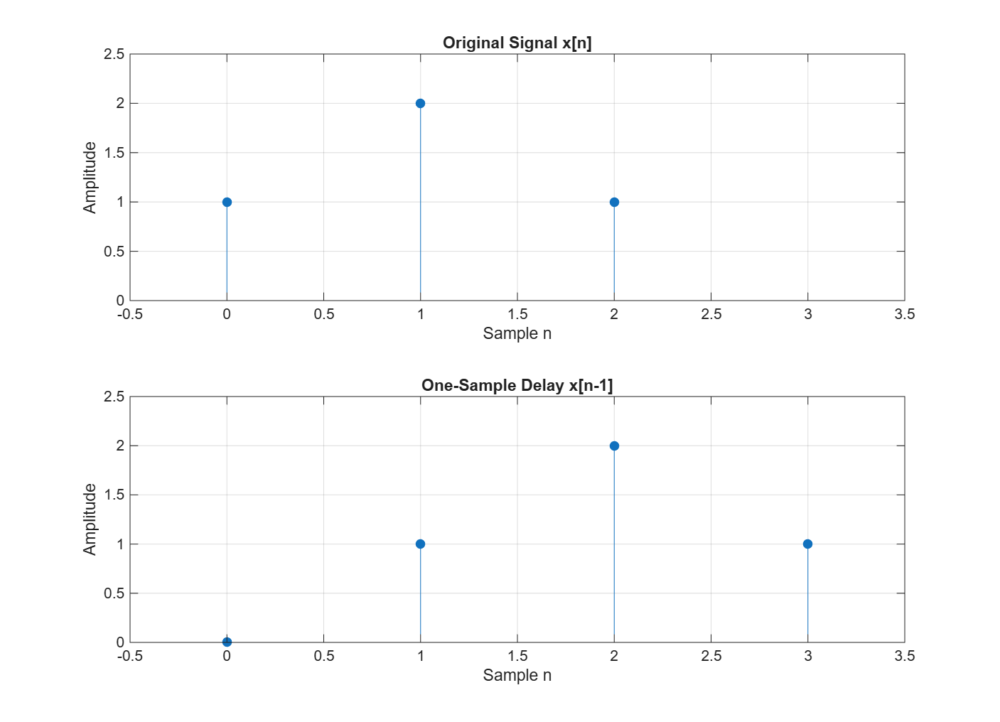
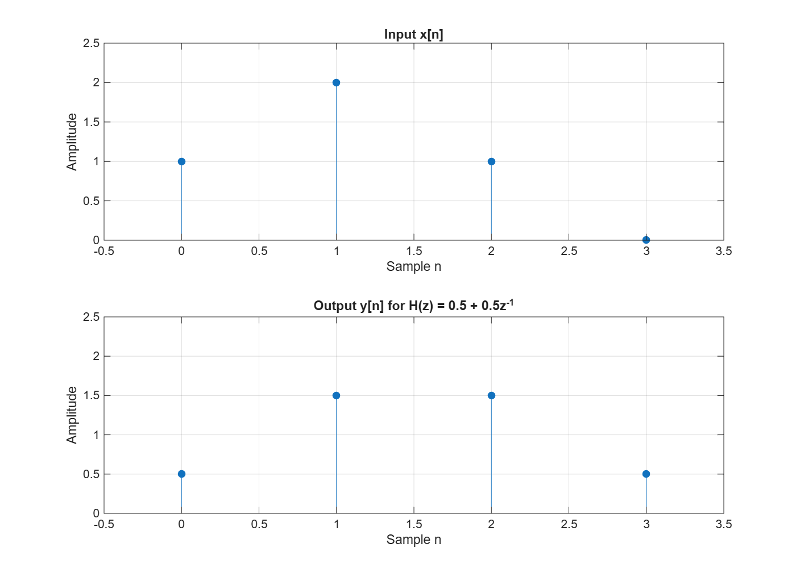
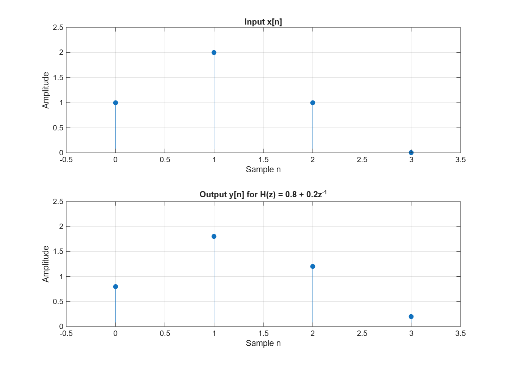

# Z-Transform and Delays

This assignment looks at a short discrete-time signal, its Z-transform, a one-sample delay, and a simple system that averages the current and the previous input.

## Files

| File | Content |
|---|---|
| `zTransformDelay.m` | MATLAB script for Part 1, Part 2 and Task 6 |
| `original_and_delayed.png` | Original signal and the one-sample delayed signal |
| `averaging_output.png` | Input and output of H(z) = 0.5 + 0.5z⁻¹ |
| `modified_output.png` | Input and output of H(z) = 0.8 + 0.2z⁻¹ |

No Symbolic Math Toolbox is used. Run `zTransformDelay.m`; it creates the three figures and prints the output samples.

## Part 1: A signal and its Z-transform

The signal starts at n = 0 and is zero outside the listed samples:

x[0] = 1, x[1] = 2, x[2] = 1

X(z) = 1 + 2z⁻¹ + z⁻²



### Task 1 – Which sample does each term of X(z) represent?

| Term | Sample | Meaning |
|---|---|---|
| 1 (= 1·z⁰) | x[0] = 1 | value at n = 0 |
| 2z⁻¹ | x[1] = 2 | value at n = 1 |
| z⁻² (= 1·z⁻²) | x[2] = 1 | value at n = 2 |

The coefficient is the sample value, and the power of z⁻¹ tells at which sample index n it occurs.

### Task 2 – Z-transform of the delayed signal

The delayed signal is x_d[n] = x[n − 1] = [0, 1, 2, 1], so every sample is one position later:

X_d(z) = 0 + 1z⁻¹ + 2z⁻² + 1z⁻³ = z⁻¹ + 2z⁻² + z⁻³

### Task 3 – Why does a one-sample delay multiply X(z) by z⁻¹?

In X(z) every sample x[n] is attached to z⁻ⁿ. After a delay of one sample the same value appears at index n + 1, so it is now attached to z⁻⁽ⁿ⁺¹⁾ = z⁻¹ · z⁻ⁿ. This happens to every term, so z⁻¹ can be taken out as a common factor:

X_d(z) = z⁻¹ + 2z⁻² + z⁻³ = z⁻¹ (1 + 2z⁻¹ + z⁻²) = z⁻¹ X(z)

The second plot in the figure shows the same thing in the time domain: the three stems have the same heights, but each one is moved one step to the right.

## Part 2: A system with one sample delay

y[n] = 0.5x[n] + 0.5x[n − 1]

Y(z) = 0.5X(z) + 0.5z⁻¹X(z), so H(z) = Y(z)/X(z) = 0.5 + 0.5z⁻¹



### Task 4 – y[0] to y[3] by hand

The input is x = [1, 2, 1, 0] and x[−1] = 0.

| n | Calculation | y[n] |
|---|---|---|
| 0 | 0.5·1 + 0.5·0 | 0.5 |
| 1 | 0.5·2 + 0.5·1 | 1.5 |
| 2 | 0.5·1 + 0.5·2 | 1.5 |
| 3 | 0.5·0 + 0.5·1 | 0.5 |

MATLAB output from `filter(b, a, xInput)`:

```
Output samples for b = [0.5 0.5]:
    0.5000    1.5000    1.5000    0.5000
```

The hand calculation and MATLAB give the same four values. The extra zero added to the input is needed to see y[3], which still contains half of x[2].

### Task 5 – How does b = [0.5 0.5] represent the two terms of H(z)?

`b` holds the numerator coefficients of H(z) in increasing powers of z⁻¹:

- `b(1) = 0.5` is the coefficient of z⁰. It multiplies the current input x[n].
- `b(2) = 0.5` is the coefficient of z⁻¹. It multiplies the previous input x[n − 1].

`a = 1` means the denominator is 1, so the output does not depend on earlier outputs (no feedback).

### Task 6 – Changed system H(z) = 0.8 + 0.2z⁻¹

With `b = [0.8 0.2]` the system is y[n] = 0.8x[n] + 0.2x[n − 1].



```
Output samples for b = [0.8 0.2]:
    0.8000    1.8000    1.2000    0.2000
```

The current input x[n] now has more influence, because its weight is 0.8 and the previous input only has 0.2. The output therefore looks more like the input itself: the peak at n = 1 is 1.8 (close to the input value 2), while the equal-weight system gave 1.5. The leftover value at n = 3 is also smaller (0.2 compared with 0.5), because less of the previous sample is carried over.

## AI usage

AI (Claude) was used for learning: to understand how the coefficient vector `b` in `filter` is related to H(z). The hand calculations were compared with the MATLAB output.
