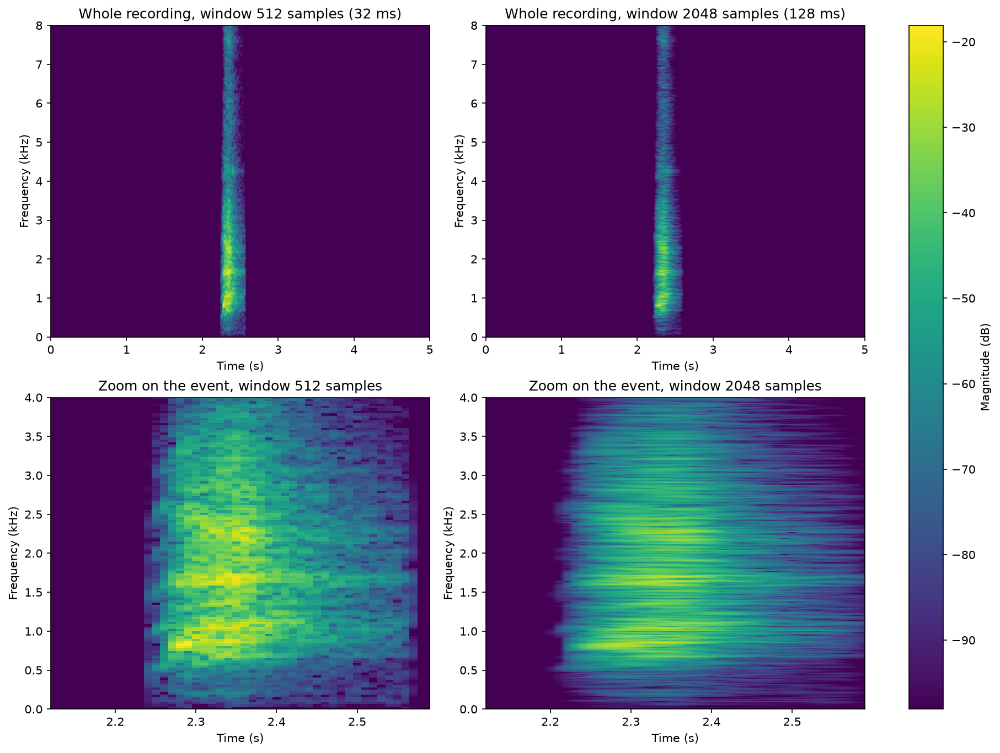

# Individual Assignment – Audio Analysis and AI

Md Mohiuddin Mollah – Digital Signal Processing 2026

## Selected option

**Option C – Analyse an environmental sound**

Question: where in time and frequency is the sound event in a dog recording, and how does the spectrogram window length (512 or 2048 samples) change what can be seen?

## Audio file

| File | Category | Source |
|---|---|---|
| `audio/1-100032-A-0.wav` | dog | ESC-50 dataset, fold 1, Freesound clip 100032 |

The original file is 5 s long, mono, 44.1 kHz, 16-bit. Only this one clip is included in the repository, not the dataset.

Attribution: ESC-50: Dataset for Environmental Sound Classification, K. J. Piczak (2015), https://github.com/karolpiczak/ESC-50. The clips come from Freesound.org and the dataset is released under the Creative Commons Attribution-NonCommercial licence.

## Settings

| Setting | Value |
|---|---|
| Analysis sample rate | 16 kHz (resampled from 44.1 kHz with `scipy.signal.resample_poly`, factor 160/441) |
| Spectrogram window lengths | 512 samples (32 ms) and 2048 samples (128 ms) |
| Hop length | 160 samples (10 ms) for both |
| Window type | Hann |
| Colour range | Same for both spectrograms (80 dB below the common maximum) |
| Active-interval threshold | Short-time RMS above 10 % of its maximum (10 ms frames) |

## Files

| File | Content |
|---|---|
| `analysis.ipynb` | Executed notebook with code, outputs and written explanations |
| `results/waveform.png` | Waveform with the active interval marked, and a zoom on the event |
| `results/spectrum.png` | Single-sided amplitude spectrum |
| `results/spectrogram_comparison.png` | Spectrograms with 512 and 2048 samples, whole recording and zoom |
| `results/results_table.csv` | Window comparison and energy per frequency band |

## How to run the notebook

1. Install Python 3 with `numpy`, `scipy`, `matplotlib` and `jupyter`:
   ```
   pip install numpy scipy matplotlib jupyter
   ```
2. Keep `audio/1-100032-A-0.wav` in the `audio` folder next to the notebook.
3. Open `analysis.ipynb` in Jupyter and choose **Run All**, or run:
   ```
   jupyter nbconvert --to notebook --execute --inplace analysis.ipynb
   ```
   The notebook recreates the files in `results/`.

No random numbers are used, so the results are the same on every run.

## Results

| Window | Length | Bin spacing | Event visible | Spectral peaks in the loudest frame |
|---|---:|---:|---|---:|
| 512 samples | 32 ms | 31.25 Hz | 2.27–2.43 s (0.16 s) | 9 |
| 2048 samples | 128 ms | 7.81 Hz | 2.24–2.45 s (0.21 s) | 43 |



- Relevant time interval: **2.27 s to 2.44 s**, one single bark (3.4 % of the recording).
- Relevant frequency region: **about 0.8 to 2.4 kHz**. 90 % of the energy lies between 798 Hz and 2390 Hz, with the strongest line at 852 Hz.

## Main conclusion

The window length trades time resolution against frequency resolution. The 512-sample window shows the bark with a sharp start and the correct length, but with coarse frequency detail. The 2048-sample window resolves many more spectral lines (43 peaks compared with 9), but it smears the 0.17 s bark to 0.21 s and makes it appear to start earlier. For locating this short event the 512-sample window is the better choice; for studying its frequency content the 2048-sample window is better.

## One limitation

The analysis uses a single recording with one bark, so the time interval and frequency region describe this clip only. The interval also depends on the thresholds I chose (10 % of the maximum level, and 20 dB below the maximum in the spectrograms).

## AI usage

AI (Claude) was used for learning and for help with the notebook code. The numbers above are the outputs stored in the executed notebook.
