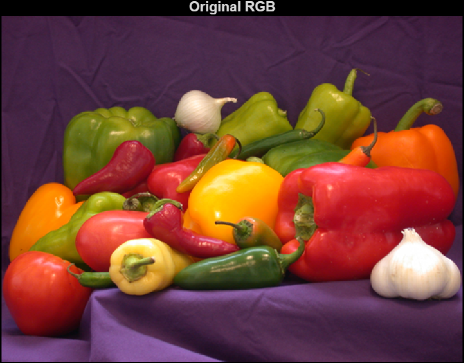
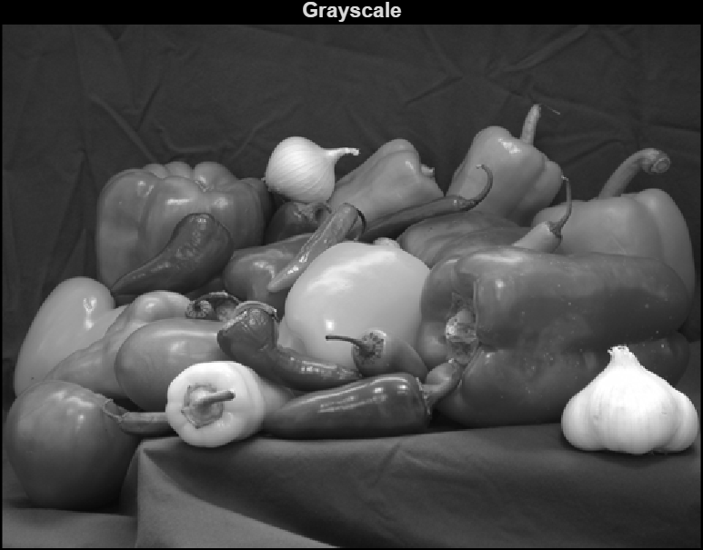
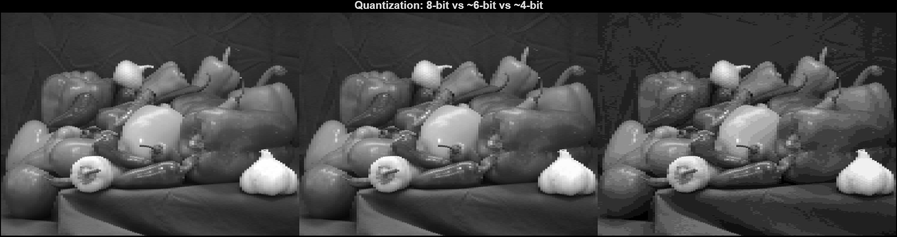
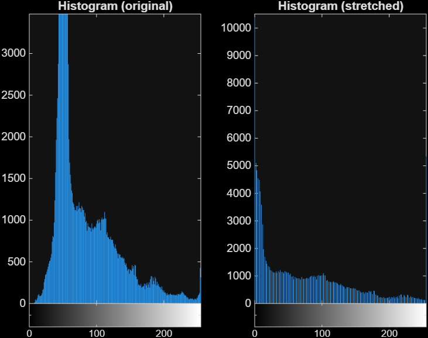
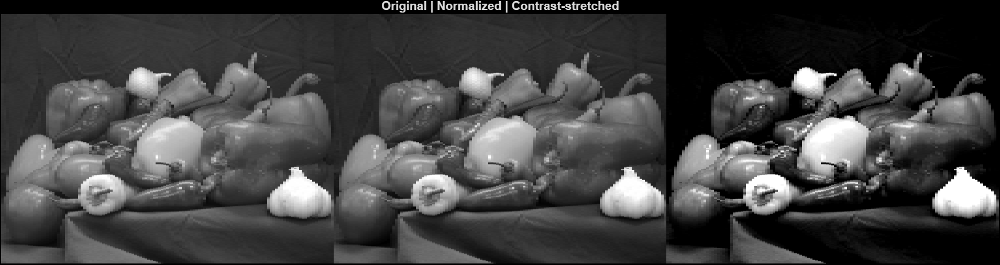
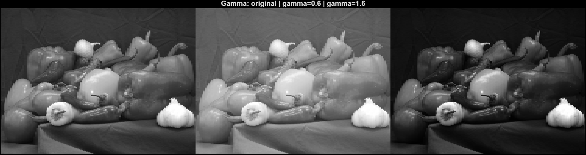
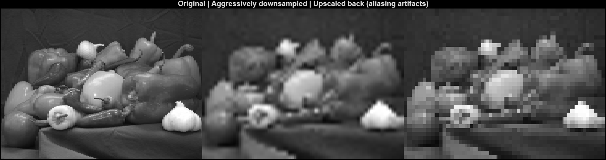

# Lab 1 – Image as a 2D Signal

Md Mohiuddin Mollah – Digital Signal Processing 2026

Sampling, quantization, histograms and enhancement on the MATLAB sample image `peppers.png`.

- Script: `lab1_image_as_2d_signal.m` (the lab code, with a few lines marked "(added)" that print numbers and save the figures)
- Run in MATLAB R2026b with the Image Processing Toolbox. Press Run; the figures are saved as `figure_01.png` to `figure_07.png`.

## 0) Load and inspect the image





```
Class: uint8 | Range: [8, 255] | Size: 384 x 512
```

The colour image is converted to one luminance channel with `rgb2gray`. The grayscale image is a 2D signal: 384 rows by 512 columns of samples, each stored with 8 bits. The darkest pixel is 8 and the brightest is 255, so almost the full 8-bit range is used.

## 1) Quantization and dynamic range



```
Grey levels used: 8-bit 248 | ~6-bit 62 | ~4-bit 16
```

The image is requantized by rounding the grey values down to steps of 4 (about 6 bits) and steps of 16 (about 4 bits). With 62 levels the image looks the same as the original. With only 16 levels the smooth background and the surfaces of the peppers break up into flat patches with visible borders (banding).

## 2) Histogram and contrast stretching





```
After stretching: 33.3 % of pixels at 0, 2.7 % at 255
```

The original histogram has a tall peak around grey value 50, so most pixels are dark. `imadjust(I,[0.2 0.8],[0 1])` maps the input range 0.2–0.8 to the full output range. The histogram is spread out, and everything below 0.2 is clipped to black (33.3 % of the pixels) and everything above 0.8 to white (2.7 %). The peppers get more contrast, but the dark background loses its detail. `mat2gray` only rescales the minimum and maximum to 0 and 1, so it changes very little here because the image already uses nearly the full range.

## 3) Gamma correction



```
Mean grey value: original 81.7 | gamma 0.6 124.4 | gamma 1.6 47.3
```

Gamma correction is a nonlinear mapping, output = input^gamma on values scaled to 0–1. Gamma 0.6 raises the mean from 81.7 to 124.4 and makes the dark background visible. Gamma 1.6 lowers the mean to 47.3 and hides the shadows. Black and white stay where they are; only the mid-tones move.

## 4) Sampling and aliasing



```
Downsampled size: 39 x 52 (from 384 x 512)
```

The image is reduced to 10 % of its size with nearest-neighbour sampling, which keeps every tenth pixel and throws the rest away without any filtering. After scaling back up, the image is made of large blocks, curved edges become staircases, and thin details such as the stems and the highlights are broken or missing.

## 6) Reflections

**1. Relate bit-depth to the banding you observed.**
Each bit that is removed halves the number of grey levels. At about 6 bits (62 levels) the steps between neighbouring levels are too small to see. At about 4 bits (16 levels) one step is 16 grey values, so a smooth gradient can no longer be shown smoothly. It is drawn as a few flat areas with sharp borders between them. This banding is most visible in slowly changing regions, here the background cloth and the pepper surfaces, and hardly visible in textured or edge regions.

**2. How does contrast stretching change the histogram and the visibility of details?**
It stretches the chosen input range (0.2–0.8) over the whole output range, so the histogram becomes wider and the grey levels inside that range are further apart. Details in the mid-tones become easier to see. The values outside the range pile up at 0 and 255, which shows as the spikes at both ends of the stretched histogram, and the detail in those regions is lost (here one third of the pixels became pure black). It is a linear remapping, unlike gamma correction.

**3. Why does aggressive downsampling cause aliasing?**
Keeping every tenth pixel lowers the sampling rate by a factor of 10 in both directions. According to the Nyquist criterion the new sampling rate can only represent spatial frequencies up to half of it, which is one tenth of what the original could hold. The image contains finer detail than that (edges, stems, highlights), and because no low-pass filter is applied first, those high frequencies fold back and appear as false coarse patterns: jagged edges and blocks. Filtering before sampling (the default in `imresize` for bilinear and bicubic) would remove them first.

## AI usage

AI was used for learning.
