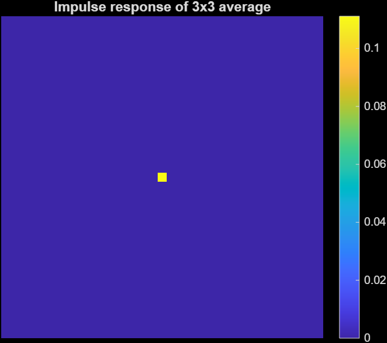
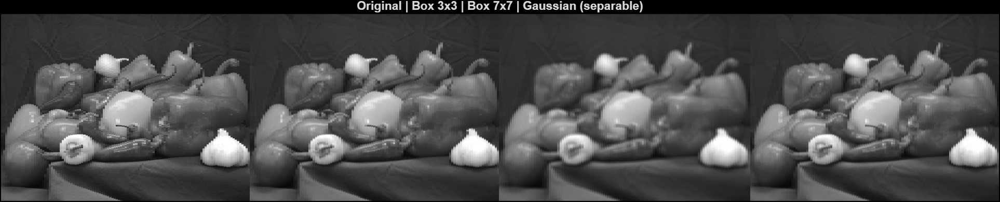
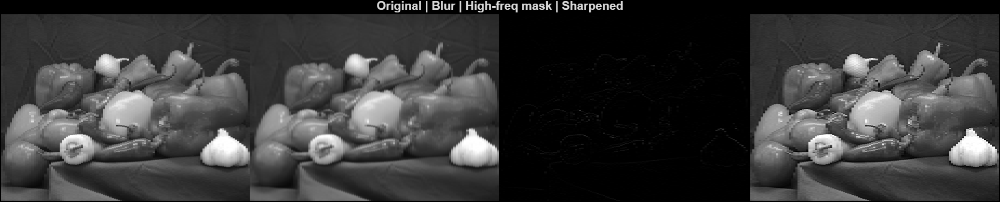
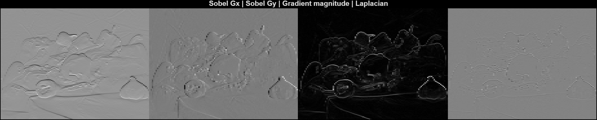
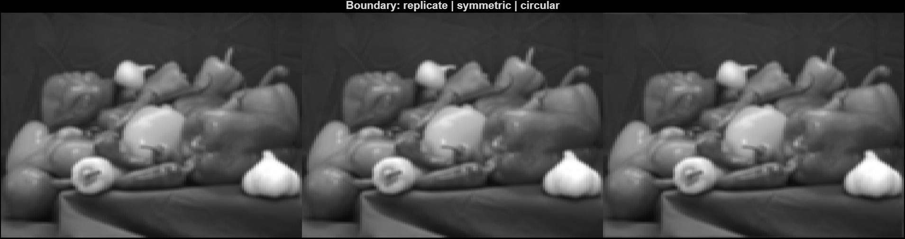

# Lab 2 – 2D Convolution & FIR Filters (Blur, Sharpen, Edges)

Md Mohiuddin Mollah – Digital Signal Processing 2026

2D FIR filtering on the grayscale version of `peppers.png` (384 × 512, values 0–1).

- Script: `lab2_convolution_fir_filters.m` (the lab code, with a few lines marked "(added)" that print numbers and save the figures)
- Run in MATLAB R2026b with the Image Processing Toolbox. The figures are saved as `figure_01.png` to `figure_05.png`.

## 1) Delta image and impulse response



```
Impulse response: 9 non-zero pixels, each 0.1111, sum 1.0000
```

A delta image has a single 1 in the middle and zeros elsewhere. Convolving it with the 3 × 3 averaging kernel gives back the kernel itself: a 3 × 3 square of nine pixels with the value 1/9. This is the 2D version of the impulse response h[m,n]. The values add up to 1, so the filter does not change the average brightness of an image.

## 2) Low-pass: box and Gaussian, separability



```
Max difference, 2D Gaussian vs two 1D passes: 4.44089e-16
Multiplications per pixel: 2D 7x7 = 49, separable = 14
```

All three kernels blur the image. The 3 × 3 box blurs slightly, the 7 × 7 box blurs strongly, and the 7 × 7 Gaussian (sigma 1.2) blurs less than the box of the same size because most of its weight is in the centre. The Gaussian kernel is built as the product of a 1D column and a 1D row, so it is separable. Filtering with the two 1D kernels one after the other gives the same result as the 2D kernel: the largest difference is 4.4·10⁻¹⁶, which is rounding error.

## 3) Unsharp masking



The blurred image is subtracted from the original. What is left (the mask) contains only the high frequencies: edges and fine texture, with flat areas near zero. Adding this mask back to the original with gain 1 makes the edges steeper, so the sharpened image looks crisper. The result is clipped to 0–1.

## 4) Edges: Sobel and Laplacian



Sobel Gx responds to brightness changes in one direction and Gy to changes in the other, so each one shows only edges of one orientation. The gradient magnitude `hypot(Gx, Gy)` combines them and shows all edges as bright lines. The Laplacian is a second-derivative filter: it responds to edges of every direction at once, but also to fine texture and noise, and its output is weaker and thinner.

## 5) Correlation and convolution

```
Max difference (conv2 vs imfilter with conv): 3.33067e-16
```

`conv2` and `imfilter(...,'conv')` give the same result (difference 3.3·10⁻¹⁶). `imfilter` uses correlation by default, which does not flip the kernel. Convolution flips it by 180°. For a symmetric kernel such as the box filter the flip changes nothing, so correlation and convolution are identical here. For a non-symmetric kernel such as Sobel the sign of the result would change.

## 6) Boundary handling



```
Max difference replicate vs symmetric: 0.0680 | replicate vs circular: 0.1385
Max difference in the interior (more than 3 pixels from the border): 0
```

The three results look the same in the montage, and inside the image they are exactly the same (difference 0 for all pixels more than 3 pixels from the border). They differ only in the 3-pixel frame where the 7 × 7 kernel reaches outside the image.

## 7) Reflections

**1. Why is Gaussian preferred over a large box low-pass filter?**
A box kernel has sharp edges in space, so its frequency response is a sinc shape with side lobes: some high frequencies are let through again, and some are inverted. This can leave blocky artefacts and faint patterns. A Gaussian kernel falls off smoothly, and its frequency response is also a Gaussian with no side lobes, so it attenuates higher frequencies more and more without ripples. It also weights near pixels more than far ones, which keeps edges better for the same amount of noise reduction, and it is separable and the same in every direction.

**2. What does separability do for the computational cost?**
A separable K × K kernel can be applied as one K × 1 pass and one 1 × K pass. The cost per pixel falls from K² to 2K multiplications. For the 7 × 7 kernel in this lab that is 14 multiplications where the full 2D kernel needs 49, about 3.5 times less, and the result is identical. The saving grows with the kernel size.

**3. How do boundary modes change the corners and edges?**
Near the border the kernel needs pixels that do not exist, and the mode decides what is used. `replicate` repeats the last pixel outwards, `symmetric` mirrors the image at the border, and `circular` wraps around and takes pixels from the opposite side. Replicate and symmetric give almost the same border (largest difference 0.068), because both use nearby pixels. Circular differs more (0.139), because pixels from the other side of the image, which can have a very different brightness, are mixed into the border and corners. The interior of the image is not affected by the choice.

## AI usage

AI was used for learning.
