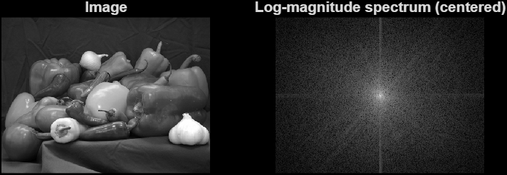
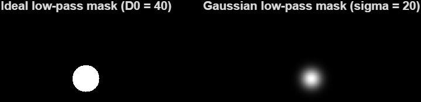
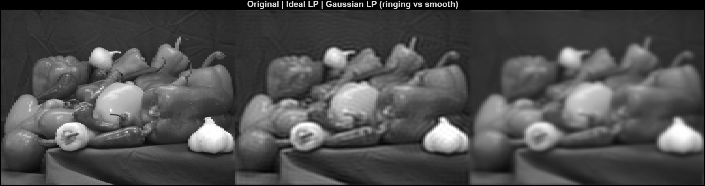
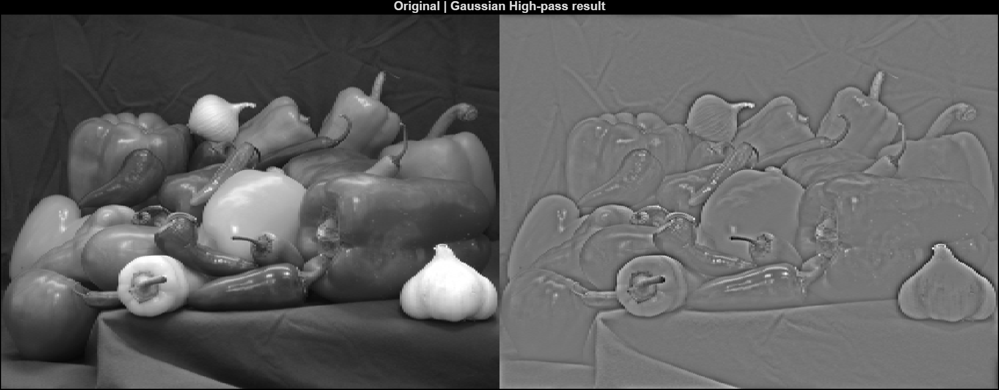
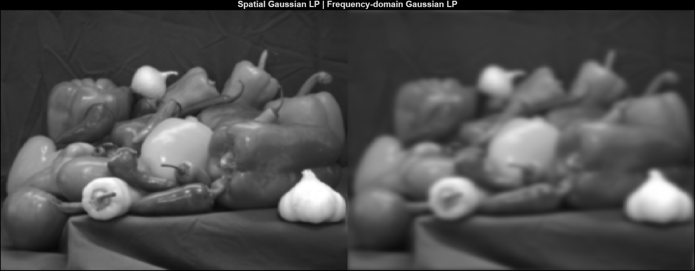

# Lab 3 – Frequency-Domain Filtering with fft2

Md Mohiuddin Mollah – Digital Signal Processing 2026

Filtering the grayscale `peppers.png` image (384 × 512) by multiplying its 2D spectrum with a filter mask.

- Script: `lab3_frequency_domain_filtering.m` (the lab code, with a few lines marked "(added)" that print numbers, show the filter masks and save the figures)
- Run in MATLAB R2026b with the Image Processing Toolbox. The figures are saved as `figure_01.png` to `figure_05.png`.

## 1) Magnitude spectrum



`fft2` gives the 2D spectrum and `fftshift` moves the zero frequency to the centre. The log scale is needed because the low frequencies are thousands of times stronger than the high ones. The spectrum is brightest in the centre, which means most of the image energy is in the low frequencies (large smooth areas). The bright lines through the centre come from the strong edges in the image.

## 2) Ideal and Gaussian low-pass masks



Both masks are centred on the zero frequency. The ideal low-pass is a disc: it is 1 inside the radius D0 = 40 and 0 outside, with a hard edge. The Gaussian low-pass (sigma 20) falls smoothly from 1 in the centre towards 0.

## 3) Low-pass filtering in the frequency domain



```
Ideal LP output range:    [0.0110, 1.0528]
Gaussian LP output range: [0.0461, 0.9964]
Share of spectrum energy kept: ideal 99.34 % | Gaussian 96.77 %
```

Both results are blurred, because the high frequencies are removed. The ideal filter leaves ripples that run parallel to the strong edges, for example around the garlic and the bright pepper. These ripples also push some pixels above the original maximum of 1 (up to 1.053). The Gaussian result is smoother and stays inside the range 0–1, with no ripples. Both filters keep more than 96 % of the energy, which shows how little of the image energy is in the high frequencies.

## 4) High-pass by complement



The high-pass mask is 1 minus the Gaussian low-pass mask, so it removes exactly what the low-pass keeps. The result shows only edges and fine texture. The large smooth areas become a uniform mid-grey, because their low-frequency content, including the average brightness, is removed.

## 5) Spatial and frequency-domain Gaussian low-pass



```
Spatial vs frequency Gaussian LP: mean abs difference 0.0157, max 0.2934
Equivalent spatial sigma of the frequency filter: 4.07 px (horizontal), 3.06 px (vertical)
```

Both images are Gaussian low-pass results, but they are not equally strong. The spatial kernel has sigma 1.2 pixels. The frequency mask with sigma 20 corresponds to a spatial Gaussian of about 3 to 4 pixels, so the frequency-domain result is clearly more blurred. That explains the mean difference of 0.016 and the larger differences at edges. With matching parameters the two methods would give the same image, apart from the border, where `fft2` treats the image as periodic and `imfilter` used `replicate`.

## 6) Reflections

**1. Why does the ideal low-pass filter cause ringing?**
The ideal filter cuts the spectrum off abruptly at D0. A sharp cut-off in the frequency domain corresponds to a sinc-like (Bessel-shaped) impulse response in the spatial domain, which oscillates and has positive and negative side lobes. Filtering is a convolution with that response, so every sharp edge in the image is surrounded by copies of those oscillations. This is the Gibbs phenomenon. In my result it shows as ripples next to edges and as values above 1. The Gaussian mask has no sharp cut-off, and its impulse response is a Gaussian without side lobes, so it does not ring.

**2. What does fftshift do visually?**
`fft2` puts the zero frequency in the top-left corner, so the low frequencies end up in the four corners of the spectrum. `fftshift` swaps the quadrants so that the zero frequency is in the centre. Low frequencies are then near the centre and high frequencies near the borders, which is easier to read and makes it simple to build circular masks from the distance to the centre. It only rearranges the values; `ifftshift` undoes it before `ifft2`.

**3. When is frequency-domain filtering computationally preferable?**
When the filter is large. Spatial convolution costs about K² multiplications per pixel for a K × K kernel, so the cost grows quickly with the kernel size. Frequency-domain filtering costs two FFTs and one multiplication per pixel, about N log N in total, and this does not depend on the size of the filter. It is also the natural choice when the filter is defined by its frequency response (ideal, band-pass or notch filters) or when the same image is filtered many times. For small kernels such as 3 × 3 or separable ones, spatial filtering is faster and handles the borders better.

## AI usage

AI was used for learning.
