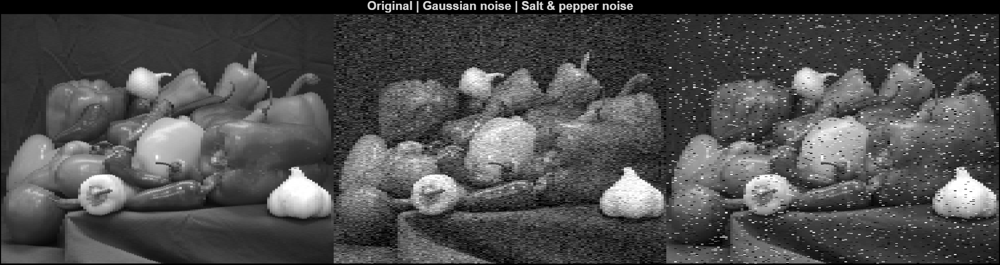
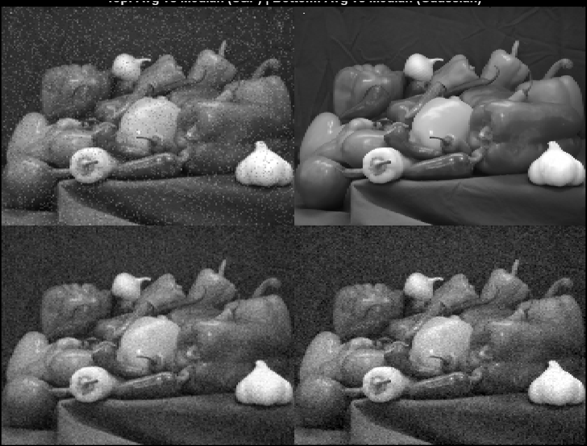
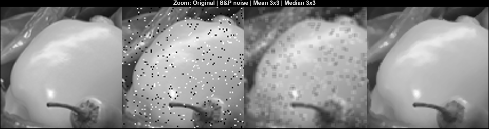

# Lab 4 – Noise and Filtering

Md Mohiuddin Mollah – Digital Signal Processing 2026

Gaussian and salt-and-pepper noise are added to the grayscale `peppers.png` image, and mean, Gaussian and median filters are compared with MSE and SNR.

- Script: `lab4_noise_and_filtering.m` (the lab code, with lines marked "(added)": a fixed random seed `rng(1)`, SNR values, a results table, a zoomed figure and saving of the figures)
- Run in MATLAB R2026b with the Image Processing Toolbox. The figures are saved as `figure_01.png` to `figure_03.png`.

## 1) Add different noise types



Gaussian noise (variance 0.01) adds a small random value to every pixel, so the whole image looks grainy. Salt-and-pepper noise (density 0.05) changes only 5 % of the pixels, but sets them to pure black or pure white, so it appears as isolated dots.

## 2) Quality metrics

```
MSE Gaussian: 0.0097 | MSE S&P: 0.0158
SNR Gaussian: 11.49 dB | SNR S&P: 9.34 dB
```

MSE is the mean squared difference from the clean image (lower is better). SNR is the signal power divided by the noise power in dB (higher is better). The Gaussian MSE of 0.0097 agrees with the noise variance of 0.01 that was requested. The salt-and-pepper image has a higher MSE although only 5 % of its pixels are changed, because each changed pixel has a very large error.

## 3) and 4) Linear filters and the median filter





Top row (salt-and-pepper): the mean filter does not remove the dots. It spreads each one into a grey 3 × 3 square, which is clearly visible in the zoom. The median filter removes them completely and keeps the edges sharp.

Bottom row (Gaussian noise): the mean and the median filter both reduce the grain, and both soften the image a little.

## 5) Metrics after filtering

```
After filtering, MSE S&P avg=0.0021, med=0.0001
```

| Image | MSE | SNR (dB) |
|---|---:|---:|
| Gaussian noise, no filter | 0.0097 | 11.49 |
| Gaussian noise, mean 3×3 | 0.0013 | 20.29 |
| Gaussian noise, Gaussian 3×3 (sigma 0.7) | 0.0018 | 18.68 |
| Gaussian noise, median 3×3 | 0.0019 | 18.60 |
| S&P noise, no filter | 0.0158 | 9.34 |
| S&P noise, mean 3×3 | 0.0021 | 18.04 |
| S&P noise, median 3×3 | 0.0001 | 30.32 |

For Gaussian noise the mean filter is best (20.3 dB), ahead of the Gaussian and the median filter (about 18.6 dB each). For salt-and-pepper noise the median filter is far ahead: 30.3 dB against 18.0 dB for the mean filter, an MSE that is about 20 times lower.

## 6) Reflections

**Which noise is best removed by the median filter, and why?**
Salt-and-pepper noise. The median filter sorts the nine values in each 3 × 3 window and takes the middle one. A black or white outlier always ends up at one end of the sorted list, so it is never chosen as long as fewer than half of the pixels in the window are corrupted. The outlier is replaced by a real neighbouring value and has no effect on the result. A mean filter includes the outlier in the average, so it only spreads the error over nine pixels. For Gaussian noise every pixel is slightly wrong and there are no outliers to reject, so averaging works better, as the table shows.

**Why does linear filtering blur edges more?**
A linear filter replaces each pixel with a weighted sum of its neighbours, and it does this in the same way everywhere. At an edge the window contains pixels from both sides, so the output is a mixture of the dark and the bright side and the step becomes a ramp. In frequency terms, a low-pass filter removes high frequencies, and edges are made of high frequencies just as noise is, so the filter cannot remove one without the other. The median is not a mixture: it picks one of the existing values, usually from the side that has the majority in the window, so a step edge stays a step.

**How could adaptive filters preserve detail?**
By changing the amount of smoothing from pixel to pixel using local information. Examples:

- Use the local variance: smooth strongly where the neighbourhood is flat (variance close to the noise variance) and little where the variance is high because of an edge. This is what the adaptive Wiener filter `wiener2` does.
- Weight the neighbours by how similar their intensity is to the centre pixel, so pixels across an edge are not averaged in (bilateral filter).
- For impulse noise, first detect whether a pixel is an outlier and replace only those pixels, enlarging the window only where needed (adaptive median filter).

## AI usage

AI was used for learning.
