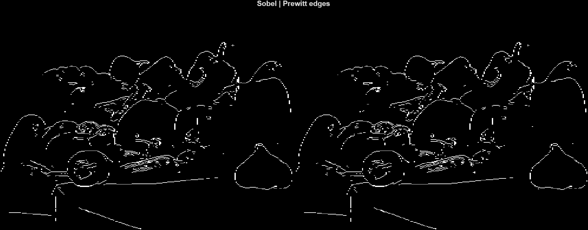
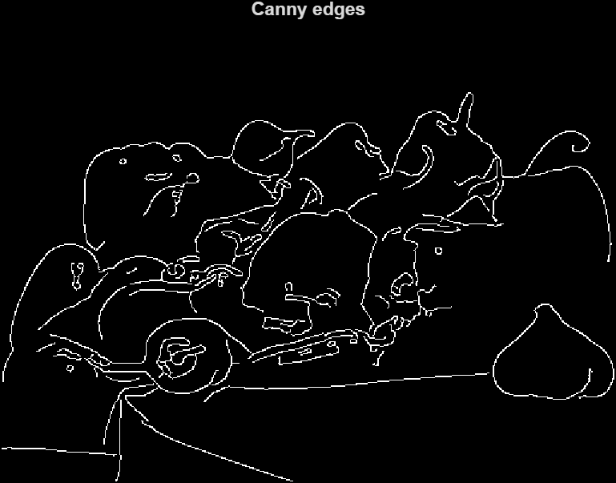
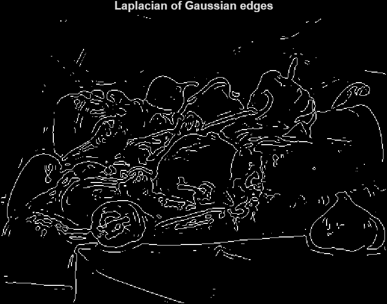
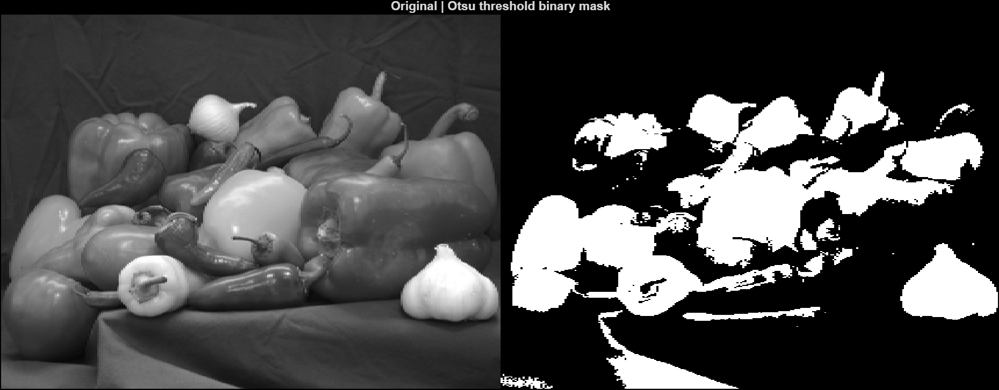
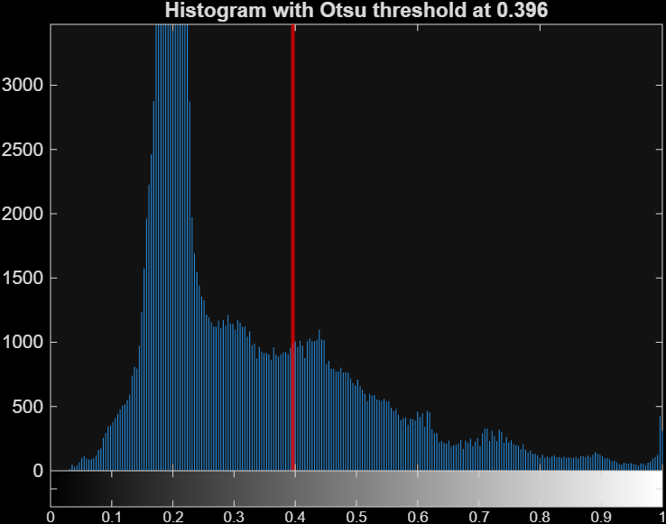
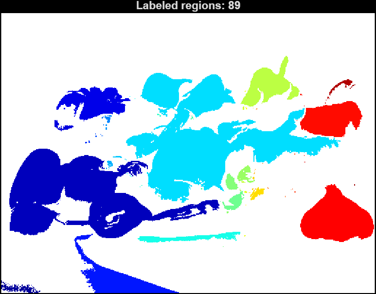

# Lab 5 – Edge Detection and Segmentation

Md Mohiuddin Mollah – Digital Signal Processing 2026

Edge detectors and Otsu thresholding on the grayscale `peppers.png` image (384 × 512).

- Script: `lab5_edge_detection_segmentation.m` (the lab code, with lines marked "(added)" that count edge pixels, plot the histogram with the threshold, measure the regions and save the figures)
- Run in MATLAB R2026b with the Image Processing Toolbox. The figures are saved as `figure_01.png` to `figure_06.png`.

## 1) Sobel and Prewitt



```
Edge pixels: Sobel 4757 | Prewitt 4740 | Canny 6821 | LoG 8386
Pixels where Sobel and Prewitt agree: 94.5 % of the Sobel edges
```

Both operators estimate the first derivative (gradient) with 3 × 3 kernels and mark a pixel as an edge when the gradient magnitude is above a threshold. The two edge maps are almost the same: they find about 4750 edge pixels each, and 94.5 % of the Sobel edge pixels are also Prewitt edge pixels. Only the strong outlines of the peppers and the garlic are found, and many of the lines are broken.

## 2) Canny



With thresholds [0.05 0.2], Canny finds 6821 edge pixels. The outlines are more complete than with Sobel: the contours are long connected lines, one pixel wide, and weaker edges such as the stems and the folds between peppers are also found.

## 3) Laplacian of Gaussian



LoG smooths the image with a Gaussian and then looks for zero crossings of the second derivative. It finds the most edge pixels (8386). The contours tend to form closed loops, but there are also many short curved lines in textured areas that are not object borders.

## 4) Otsu threshold





```
Otsu threshold: 0.3961 (grey value 101 of 255), 27.5 % of the pixels are foreground
```

Otsu's method chooses the threshold 0.396 from the histogram, shown as the red line. Pixels brighter than that become white in the mask (27.5 % of the image). The bright objects, such as the garlic, the onion and the light-coloured peppers, are separated well. The dark peppers have about the same grey level as the background, so they are missing from the mask. A single global threshold separates bright from dark, not object from background.

## 5) Label and visualize regions



```
Labeled regions: 89 | largest 19430 px | regions smaller than 50 px: 73
```

`bwlabel` gives every connected white region its own number, and `label2rgb` gives each one a colour. There are 89 regions, far more than the number of vegetables. 73 of them are smaller than 50 pixels: these are highlights and small bright specks. The largest region (19 430 pixels) is several touching peppers that were joined into one. A cleaning step such as `bwareaopen` or `imopen` would be needed before the regions could be counted as objects.

## 6) Reflections

**Which operator gives the thinnest, cleanest edges?**
Canny. Its lines are one pixel wide and mostly continuous, and it follows the real object outlines with few stray marks. Sobel and Prewitt are clean but miss weaker edges and leave gaps. LoG finds the most pixels, but many of them are responses to texture and noise.

**Why does Canny outperform simple gradient filters?**
Sobel and Prewitt do one step: compute the gradient and apply one threshold. Canny adds three steps around that:

1. Gaussian smoothing first, so noise causes fewer false edges.
2. Non-maximum suppression, which keeps only the pixel with the largest gradient across each edge, so edges are thinned to one pixel.
3. Hysteresis with two thresholds: strong edges (above 0.2 here) are always kept, and weak edges (between 0.05 and 0.2) are kept only when they are connected to a strong one. This fills gaps in real contours and still rejects isolated weak responses.

**How does Otsu relate to histogram-based thresholding?**
Otsu's method is histogram-based thresholding with the threshold chosen automatically. It uses only the histogram, not the positions of the pixels. It tries every possible threshold, splits the histogram into two classes each time, and picks the threshold that makes the two classes as compact as possible (lowest within-class variance, which is the same as the highest between-class variance). It works well when the histogram has two clear peaks. The histogram of this image is dominated by one dark peak with a long tail, so the threshold at 0.396 separates the bright objects from the rest but cannot find the dark peppers.

## AI usage

AI was used for learning.
