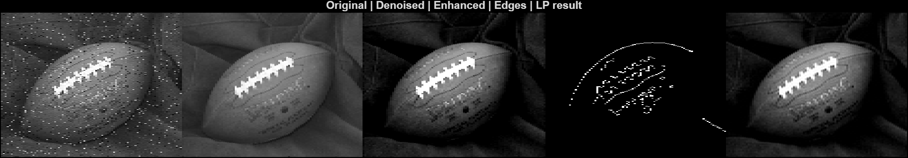
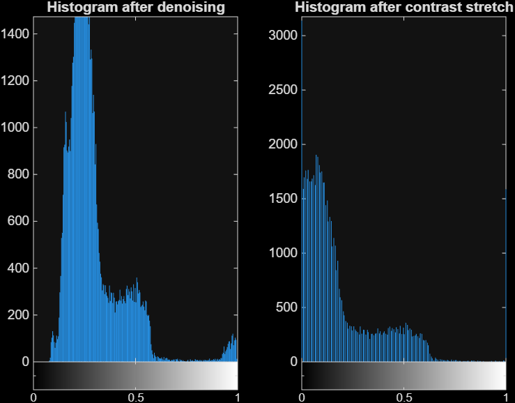
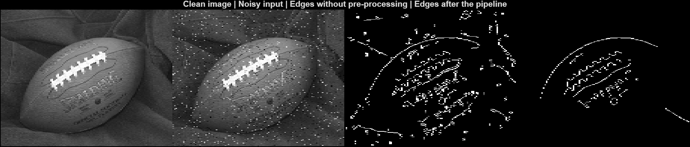
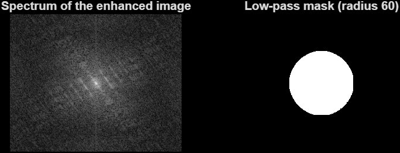

# Lab 6 – Mini Project: Integrated Image Processing

Md Mohiuddin Mollah – Digital Signal Processing 2026

Goal of the lab: combine filtering, frequency analysis, edges and enhancement in one small pipeline.

## Image and problem

- **Image:** `football.jpg`, a MATLAB sample image from the Image Processing Toolbox (256 × 320 pixels after conversion to grayscale). I used a sample image and not a photo of my own.
- **Problem:** get a clean outline of the object in a photo that is corrupted by salt-and-pepper noise. An edge detector run directly on a noisy image marks the noise as edges, so the image has to be prepared first.
- **Setup:** the noise is added in the script (`imnoise`, salt & pepper, 3 % of the pixels, `rng(1)`). This way the clean image is known and every stage can be measured against it.

Files: `lab6_image_pipeline.m` (the lab pipeline plus measurements marked "(added)") and `figure_01.png` to `figure_04.png`. Run the script in MATLAB R2026b with the Image Processing Toolbox.

## Pipeline



| Stage | Code | Purpose |
|---|---|---|
| 1. Load | `im2double(rgb2gray(imread('football.jpg')))`, then add noise | Grayscale image with values 0–1 |
| 2. Denoise | `medfilt2(I, [3 3])` | Remove the salt-and-pepper pixels |
| 3. Enhance | `imadjust(I_filt, [0.2 0.8], [0 1])` | Stretch the contrast |
| 4. Features | `edge(I_enh, 'Canny', [0.1 0.25])` | Find the outlines |
| 5. Frequency mask | ideal low-pass, radius 60, with `fft2` / `ifft2` | Keep only the low frequencies |
| 6. Display | `montage` of all stages | Compare the stages |

## Results of each stage

```
Image size: 256 x 320, grey range of the clean image: [0.05, 1.00]
PSNR against the clean image: noisy 20.20 dB | after median 30.08 dB
Noise pixels (exactly 0 or 1): before 2590 | after median 14
Grey range used (1st to 99th percentile): before [0.12, 0.96] | after [0.00, 1.00]
Standard deviation of the grey values: before 0.143 | after 0.206
Canny edge pixels: noisy image 4114 | median only 1397 | full pipeline 1475 | clean reference 2458
Edge pixels that agree with the clean reference: noisy image 39.6 % | full pipeline 97.6 %
Low-pass mask: radius 60, keeps 13.8 % of the frequency samples and 99.29 % of the energy
LP result range: [-0.043, 1.166]
```

**Stage 2 – median filter.** The noise put 2590 pixels at pure black or white. After the 3 × 3 median filter only 14 are left, and the PSNR rises from 20.2 dB to 30.1 dB. The edges of the ball and the white laces stay sharp.

**Stage 3 – contrast stretch.** The grey values between 0.2 and 0.8 are stretched over the full range, so the standard deviation of the grey values grows from 0.143 to 0.206. The ball stands out more clearly from the background. The dark cloth below 0.2 is clipped to black, which is visible in the third panel and in the histogram.



**Stage 4 – Canny edges.**



| Input to Canny | Edge pixels | Agree with the clean reference |
|---|---:|---:|
| Noisy image, no pre-processing | 4114 | 39.6 % |
| After the full pipeline | 1475 | 97.6 % |
| Clean image (reference) | 2458 | – |

Without pre-processing, Canny finds 4114 edge pixels, and only 39.6 % of them are real edges. The rest are noise dots scattered over the whole image. After the pipeline, 97.6 % of the edge pixels are real: the outline of the ball, the laces and the printed text.

The pipeline does not find all edges. It gives 1475 edge pixels where the clean image gives 2458, so about 40 % of the true edge pixels are missing. These are the weak edges, mainly the folds of the cloth in the background, which the median filter and the clipping in stage 3 remove.

**Stage 5 – frequency-domain low-pass.**



The ideal low-pass mask with radius 60 keeps 13.8 % of the frequency samples, and these hold 99.29 % of the energy of the image. The result looks like the enhanced image, only slightly softer. Because the mask has a hard cut-off, the result rings a little near the strong edges of the laces: its values go from −0.043 to 1.166, outside the 0–1 range of the input.

## Report

### The processing pipeline

The noisy image is first cleaned with a median filter, then its contrast is stretched, and then the Canny detector extracts the outlines. As a separate branch, the enhanced image is transformed to the frequency domain and low-pass filtered. The order matters: the noise has to be removed before the contrast stretch and the edge detection, because both of those steps would make the noise stronger.

### How each stage relates to DSP operations

| Stage | DSP operation |
|---|---|
| Grayscale image | A 2D discrete signal: sampled in space (256 × 320 samples) and quantized in amplitude |
| Median filter | A non-linear filter over a 3 × 3 neighbourhood. It is not a convolution and has no frequency response, but it works like a low-pass filter that rejects impulses and keeps step edges. |
| Contrast stretch | A point operation: a linear amplitude scaling with clipping, applied to each sample on its own. It changes the histogram, not the spatial frequencies. |
| Canny | Gaussian smoothing (low-pass FIR filter by convolution), then gradient filters (high-pass, a discrete derivative), then thresholding with hysteresis. Edges are the high-frequency content of the image. |
| FFT low-pass | Filtering by multiplication in the frequency domain, which equals convolution in the spatial domain. The ideal mask is a 2D "brick-wall" low-pass filter. |

### Improvements and limitations

- **Missing weak edges.** The fixed limits [0.2 0.8] clip the dark background, and its folds disappear from the edge map. Limits taken from the image itself (`stretchlim`) or local contrast enhancement (`adapthisteq`) would keep more of them.
- **Fixed parameters.** The window size, the stretch limits and the Canny thresholds were given values. They suit this image and this noise level, and another image would need other values.
- **Ringing from the ideal low-pass filter.** A Gaussian mask would avoid the overshoot. The low-pass result is also not used by the edge stage in this pipeline; it is a side branch.
- **Simulated noise.** The noise was added artificially, and only salt-and-pepper noise was tested. For Gaussian noise a median filter is not the best choice.
- **One image.** The numbers describe this image only.

## AI usage

AI was used for learning.
