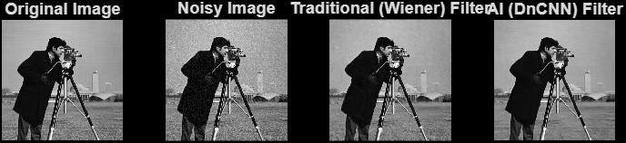
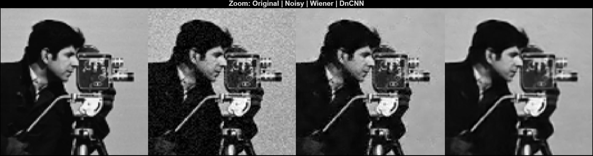

# Lab 7 – Traditional vs AI Gaussian Filters

Md Mohiuddin Mollah – Digital Signal Processing 2026

Gaussian noise is added to `cameraman.tif` and removed with a traditional adaptive filter (Wiener) and with a pre-trained deep learning denoiser (DnCNN). The results are compared with MSE, PSNR and SSIM.

- Script: `lab7_traditional_vs_ai_filters.m` (the lab code, with lines marked "(added)": a fixed random seed `rng(1)`, three more traditional filters, MSE values, run times, a zoomed figure and saving of the figures)
- Run in MATLAB R2026b. Needs the Image Processing Toolbox and the Deep Learning Toolbox.

## 1) Setup: load the image and add Gaussian noise

The image is converted to double (values 0–1) and Gaussian noise with standard deviation 0.04 (variance 0.0016) is added. The measured MSE of the noisy image is 0.00155, which agrees with the requested variance.

## 2) and 3) Wiener filter and DnCNN





- **Wiener filter (`wiener2`, 5 × 5):** estimates the local mean and variance around each pixel. Where the local variance is close to the noise variance (flat areas), it smooths strongly. Where the variance is high (edges), it smooths little. In the zoom the sky is much cleaner than in the noisy image, with a little uneven texture left, and the edges of the camera and the coat stay sharp.
- **DnCNN (`denoisingNetwork('DnCNN')`):** a convolutional network with 58 layers that was trained on many pairs of noisy and clean images. It estimates the noise in the image and subtracts it. In the zoom the sky is the smoothest of all results and the edges are kept, but very fine detail on the camera looks slightly softer than in the original.

## 4) Quantitative evaluation

Output of the lab code:

```
Method                | PSNR (dB) | SSIM
----------------------|-----------|----------
Noisy Image           |  28.0993  |   0.6307
Traditional (Wiener)  |  32.1075  |   0.8821
AI (DnCNN)            |  32.6134  |   0.8995
```

With the other traditional filters added:

| Method | MSE | PSNR (dB) | SSIM |
|---|---:|---:|---:|
| Noisy image | 0.00155 | 28.10 | 0.6307 |
| Mean 3×3 | 0.00268 | 25.71 | 0.7837 |
| Median 3×3 | 0.00224 | 26.50 | 0.7642 |
| Gaussian blur (sigma 1) | 0.00253 | 25.96 | 0.8137 |
| Wiener 5×5 | 0.00062 | 32.11 | 0.8821 |
| DnCNN | 0.00055 | 32.61 | 0.8995 |

```
Run time: Wiener 0.003 s | DnCNN 0.886 s
```

What the numbers show:

- **DnCNN is the best in every measure**, but the margin over the Wiener filter is small: 0.5 dB in PSNR and 0.017 in SSIM.
- **The simple filters make the PSNR worse than doing nothing.** Mean, median and Gaussian blur all end below the noisy image (25.7 to 26.5 dB against 28.1 dB). The noise is weak here, so the detail these filters blur away costs more than the noise they remove. Their SSIM still goes up, because the grain is gone and the structure looks cleaner. PSNR and SSIM can disagree.
- **The adaptive filter is the big step.** Going from a fixed blur to the Wiener filter gains about 6 dB. Going from Wiener to the neural network gains 0.5 dB.
- **Cost:** the Wiener filter took 0.003 s and DnCNN 0.886 s on this 256 × 256 image, roughly 300 times longer.

## 5) Visual observation and conclusion

The lab text expects DnCNN to give higher PSNR and SSIM and better visual results, and that is what I measured. The difference is smaller than the wording suggests. For this image and noise level the Wiener filter gets most of the benefit for a tiny fraction of the computing time, because it is given the true noise variance and the noise is exactly the additive white Gaussian noise it is designed for.

When to use which:

- **Traditional (Wiener):** when the noise is Gaussian and its variance is known, when the result must be fast or run on small hardware, and when the behaviour must be explainable.
- **AI (DnCNN):** when the best quality matters more than speed. It needs no noise estimate from the user. Its limit is the training data: this network is for grayscale images with Gaussian noise in a certain range, and it cannot be expected to work on other noise types or on colour images without retraining.

One limitation of this comparison: it uses one image, one noise level and one noise realisation.

## AI usage

AI was used for learning.
