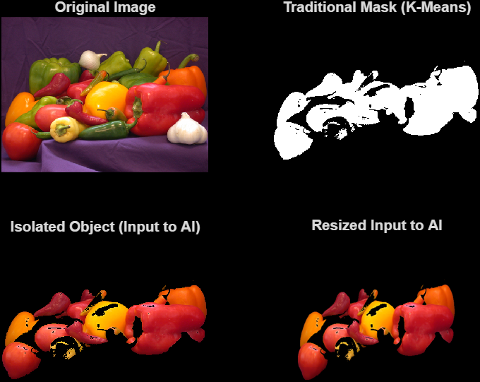
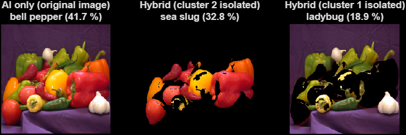

# Lab 8 – Hybrid Project: Traditional + AI

Md Mohiuddin Mollah – Digital Signal Processing 2026

A two-stage pipeline on `peppers.png`: a traditional method (k-means colour segmentation) isolates an object, and a pre-trained CNN (SqueezeNet) classifies it.

- Script: `lab8_hybrid_traditional_ai.m` (the lab code, with lines marked "(added)": a fixed random seed `rng(1)`, cluster statistics, a comparison with the AI alone and with the other cluster, and saving of the figures)
- Run in MATLAB R2026b. Needs the Image Processing Toolbox, the Deep Learning Toolbox and the SqueezeNet model.

## Section 1: Load the image and the network

`peppers.png` is a colour photo of several peppers, an onion and garlic on a purple cloth. SqueezeNet is a small CNN trained on ImageNet. It takes a 227 × 227 × 3 image and returns a probability for each of 1000 classes.

## Section 2: Traditional method – k-means colour segmentation



```
Cluster 1: 72.9 % of the pixels, mean RGB = [92 66 68]
Cluster 2: 27.1 % of the pixels, mean RGB = [198 67 31]
```

The image is converted to the L\*a\*b\* colour space and only the two colour channels (a\* and b\*) are clustered, so brightness and shadows do not matter. `imsegkmeans` with k = 2 splits the pixels into two colour groups. Cluster 2 holds the red, orange and yellow pixels (27.1 % of the image, mean colour a strong red-orange). Cluster 1 holds everything else: the purple cloth, the green peppers, the garlic and the onion.

The mask therefore does not isolate one object. It isolates a colour. The "isolated object" is several red, orange and yellow peppers together, with ragged edges and holes, on a black background.

## Section 3: AI method – classification

The isolated image is resized to 227 × 227 and classified.

```
--- Hybrid Pipeline Results ---
The AI model classified the isolated object as: **sea slug**
Confidence (Probability): 32.84%
```

## Section 4: Results analysis



I added a comparison with two other inputs, to see what the segmentation step changes:

| Input to SqueezeNet | Top 1 | Top 2 | Top 3 |
|---|---|---|---|
| AI only (original image) | bell pepper, 41.72 % | cucumber, 39.55 % | Granny Smith, 5.66 % |
| Hybrid (cluster 2 isolated) | sea slug, 32.84 % | piggy bank, 24.97 % | jack-o'-lantern, 23.49 % |
| Hybrid (cluster 1 isolated) | ladybug, 18.90 % | fig, 8.89 % | lemon, 6.07 % |

**The hybrid pipeline did not improve the result for this image. It made it worse.** The network alone, given the whole photo, answers "bell pepper", which is correct. After the segmentation step it answers "sea slug", and none of its top three guesses is a pepper.

Why this happened:

1. **The mask removes context and adds something artificial.** The network was trained on natural photos. An irregular orange-red shape on a pure black background is unlike anything it has seen, and it matches it to things with a similar colour and outline (sea slug, piggy bank, jack-o'-lantern).
2. **The segmentation is by colour, not by object.** Two colour clusters cannot separate one pepper from the others. Several peppers are merged into one blob, and the green peppers, which would also be evidence for "bell pepper", are removed.
3. **Shape and surface cues are damaged.** The mask has ragged borders and holes at highlights and shadows, and resizing the 384 × 512 image to a square changes the proportions.

The lab's idea still makes sense in general: isolating the target helps a classifier when the background is distracting and the mask really follows one object. This experiment shows that it is not automatic. The traditional stage has to produce a clean, object-shaped region, and the input still has to look like the images the network was trained on.

What I would change to make the hybrid version work:

- Crop a bounding box around one segmented region and keep the real pixels inside it, so the object is isolated but not painted onto black.
- Use more clusters, or connected-component analysis after the clustering, to pick a single pepper.
- Clean the mask with `imfill` and `imclose` before using it.

One limitation: the comparison uses a single image, and the cluster numbering of k-means depends on the random start (fixed here with `rng(1)`), so "cluster 2" is not always the red group.

## AI usage

AI was used for learning.
