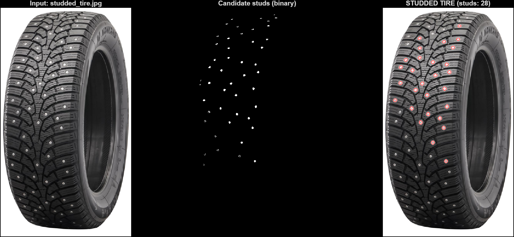
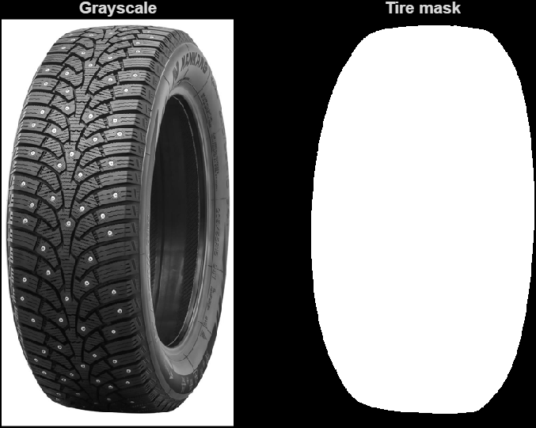
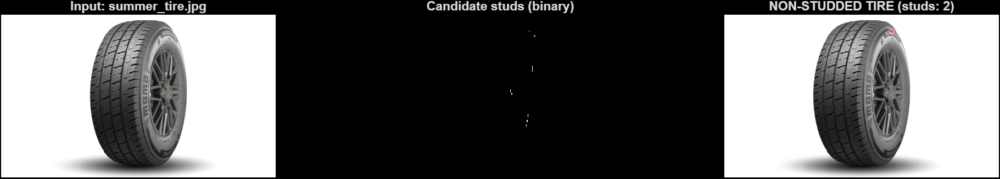
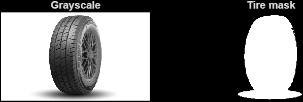

# Lab 9 – Image Preprocessing and Segmentation without AI

Md Mohiuddin Mollah – Digital Signal Processing 2026

Goal: detect metal studs on tires with image preprocessing and connected-component analysis only, and classify a tire as studded or non-studded.

## Files

| File | Content |
|---|---|
| `tire_stud_detector.m` | The completed script |
| `studded_tire.jpg` | Input image 1 (from the assignment page, where it is named `studded_tire.jpeg`) |
| `summer_tire.jpg` | Input image 2 (from the assignment page) |
| `figure_01.png`, `figure_03.png` | Original, candidate mask and final detection for each tire |
| `figure_02.png`, `figure_04.png` | Grayscale image and tire mask for each tire |

Run `tire_stud_detector.m` in MATLAB (R2026b, Image Processing Toolbox) with both images in the same folder.

## Method

| Step | What the script does |
|---|---|
| 1. Read and resize | `imread`, then `imresize(I, 0.5)` |
| 2. Grayscale | `rgb2gray` when the image has three channels |
| 3. Tire mask | The background is white, so `Igray < 200` gives the dark tire. `imfill` closes bright parts inside it, `bwareafilt(...,1)` keeps only the largest object, and `imerode` with a disk of radius 6 shrinks the mask so the bright border is not used. |
| 4. Candidate studs | A pixel is a candidate when it is bright (`Igray > 190`), much brighter than its surroundings (top-hat with a disk of radius 4, value above 90), and inside the tire mask. `bwareaopen(cand, 4)` removes single-pixel noise and `imfill` closes holes. |
| 5. Connected components | `bwconncomp` and `regionprops` with Area, Perimeter and Eccentricity |
| 6. Filter | Keep a component when its area is 4 to 120 pixels, its circularity 4πA/P² is at least 0.6 and its eccentricity is at most 0.85 |
| 7. Decision | More than 15 studs: STUDDED TIRE. Otherwise: NON-STUDDED TIRE. |
| 8. Display | Original image, candidate mask, and the image with the detected studs outlined |

The top-hat step is the important one. Brightness alone is not enough, because the summer tire has large shiny highlights on the tread and a grey rim that are also bright. A stud is small and bright on a dark surrounding, and the top-hat transform keeps exactly that kind of detail and removes larger bright areas.

## Results

```
studded_tire.jpg: size 600 x 342, tire area 163193 px, candidates 49, studs 28, density 1.72 per 10^4 px -> STUDDED TIRE
summer_tire.jpg: size 428 x 720, tire area 90708 px, candidates 9, studs 2, density 0.22 per 10^4 px -> NON-STUDDED TIRE
```

| Image | Candidates | Studs after filtering | Density (per 10 000 tire px) | Result |
|---|---:|---:|---:|---|
| `studded_tire.jpg` | 49 | 28 | 1.72 | STUDDED TIRE |
| `summer_tire.jpg` | 9 | 2 | 0.22 | NON-STUDDED TIRE |

Both tires are classified correctly, with a clear gap between 28 and 2 around the decision limit of 15.

### Studded tire





### Summer tire





## Discussion

- **The detector does not find every stud.** The studded tire has clearly more than 28 visible studs. The script finds the bright ones in the upper and middle part of the tread, where the light hits them. The studs lower down and at the sides are darker than the brightness threshold of 190 and are missed. For the classification this is enough, but the count is not a true stud count.
- **Two false detections on the summer tire.** They are small bright points near the top of the sidewall. The shape filter removes the long, thin highlights (9 candidates become 2).
- **Role of each cleaning step.** The tire mask and its erosion remove the white background and the bright tire outline. The top-hat removes large highlights and the rim. `bwareaopen` removes isolated bright pixels. The area, circularity and eccentricity limits remove elongated reflections on tread edges.
- **Limitations.** The thresholds are fixed values tuned for these two studio photos with a white background, after resizing by 0.5. A different image size, lighting or background would need new values. A more robust version would use a threshold relative to the brightness of the tire (for example a percentile) and scale the area limits with the tire size.

## AI usage

AI was used for learning.
