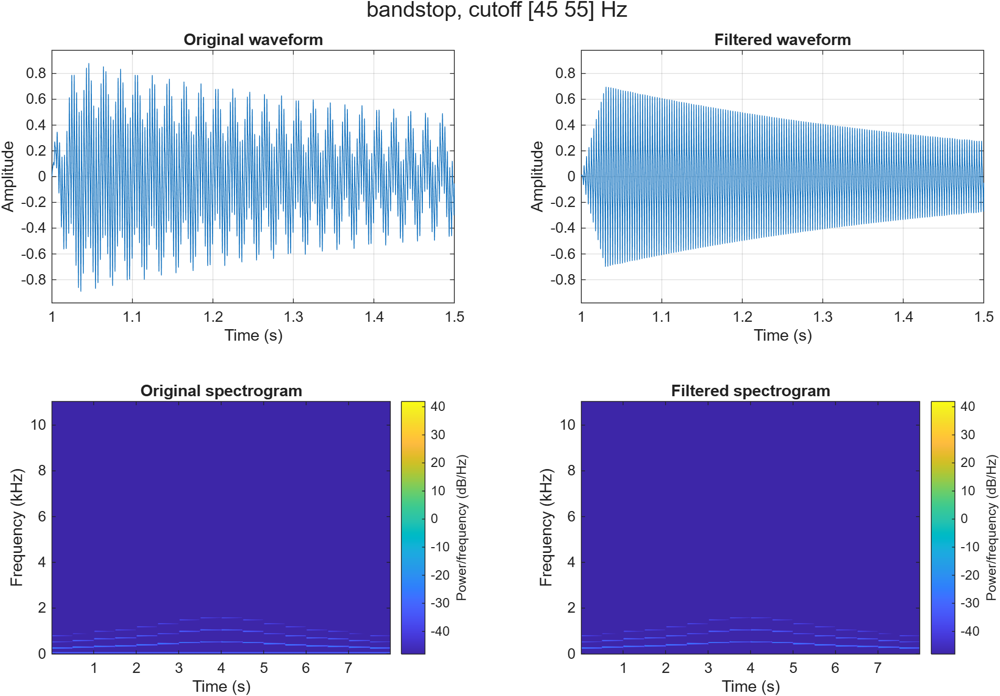

# Lecture 6 – In-class task: Inspect and filter a WAV file

Md Mohiuddin Mollah – Digital Signal Processing 2026

Goal: load a short audio file, find the unwanted part, remove it with a suitable filter and check that the result is better. I worked on this task together with a classmate, so we use the same test file and the same script.

## Files

| File | Content |
|---|---|
| `inclass_filter_wav.m` | MATLAB script (needs the Signal Processing Toolbox) |
| `hum_music.wav` | Input audio |
| `filtered.wav` | Output audio saved by the script |
| `comparison.png` | Original and filtered signal: waveforms and spectrograms |

## The audio file

`hum_music.wav` is a synthetic test file, not a real recording: a simple melody with a steady 50 Hz hum added on purpose. It was generated with AI help because no teacher-provided file was available.

| Property | Value |
|---|---|
| Sample rate | 22 050 Hz |
| Duration | 8.00 s |
| Channels | 1 (mono) |
| Bits per sample | 16 |

## Inspection

The script lists the strongest narrow peaks below 1 kHz:

| Peak | Level |
|---:|---:|
| 48.4 Hz | −26.1 dB/Hz |
| 522.2 Hz | −30.3 dB/Hz |
| 349.9 Hz | −31.0 dB/Hz |
| 393.0 Hz | −31.0 dB/Hz |
| 495.3 Hz | −31.1 dB/Hz |

The peaks from 350 Hz upwards are notes of the melody. The peak at 48.4 Hz is the problem: it is a single steady tone far below the music, which is typical for mains hum. It shows as 48.4 Hz and not exactly 50 Hz because the spectrum has a resolution of about 5 Hz (22 050 / 4096), so the hum lands in the nearest bin. In the waveform it is visible as a slow wave under the melody.

## Filter

Butterworth band-stop filter, order 4, stop band 45–55 Hz, applied with `filtfilt` (zero phase, the response is applied twice).

A band-stop filter fits because the problem is one narrow tone. A low-pass filter would not remove it, and a high-pass filter set above 50 Hz would also remove all low-frequency content. The notch only removes a 10 Hz wide band.

## Result

| Band | Before | After | Change |
|---|---:|---:|---:|
| 45–55 Hz (hum) | −16.6 dB | −70.2 dB | −53.6 dB |
| 300–3400 Hz (music) | −11.3 dB | −11.3 dB | 0.0 dB |

Both waveform plots use the same y-axis and both spectrograms use the same colour range. In the original waveform the melody rides on a slow 50 Hz wave; after filtering only the clean decaying note is left. In the original spectrogram there is a thin line at the bottom (50 Hz) for the whole clip; it is gone in the filtered one, and the lines of the melody are unchanged.

The hum is reduced by 53.6 dB and the music band is not changed, so the filter did what it should.

## What may be lost

Everything between 45 and 55 Hz is removed, also useful sound. This melody has nothing there, but a bass note near 50 Hz would be weakened. The filter also handles only the 50 Hz tone. Real mains hum usually has harmonics at 100 Hz and 150 Hz, which would need more notches.

## How to run

1. Put `inclass_filter_wav.m` and `hum_music.wav` in the same folder and make it the current folder in MATLAB.
2. Press Run. The script prints the file information and the dB values, opens three figures and saves `comparison.png` and `filtered.wav`.
3. Set `doPlayback = true` at the top to hear the original and the filtered audio with the same gain.

## AI use

AI (Claude) was used for learning and for help with the MATLAB script and the test audio file. The numbers above are printed by the script.
