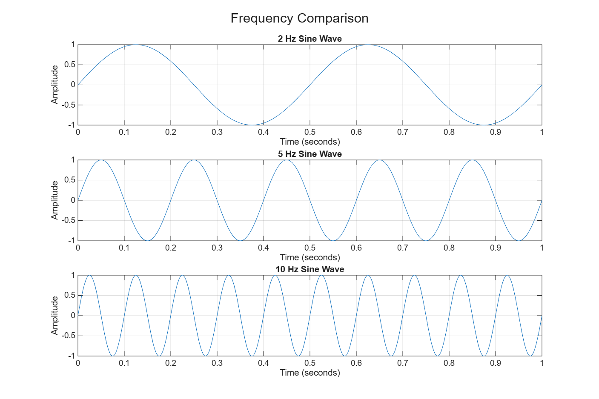
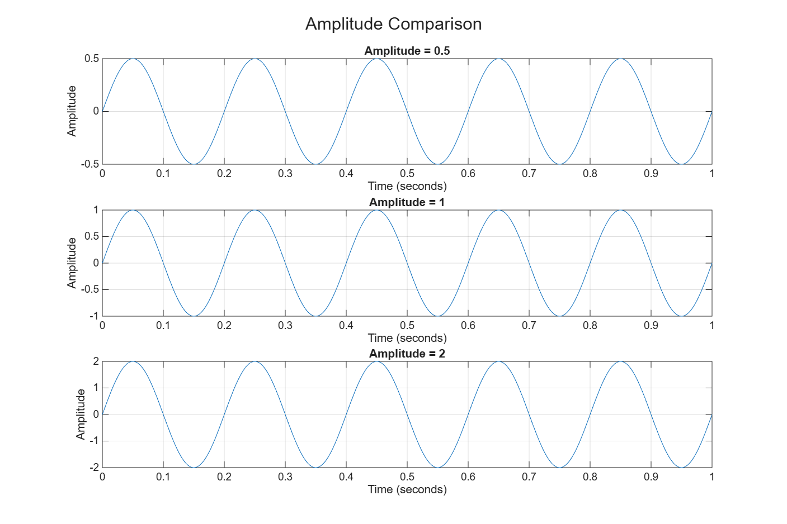
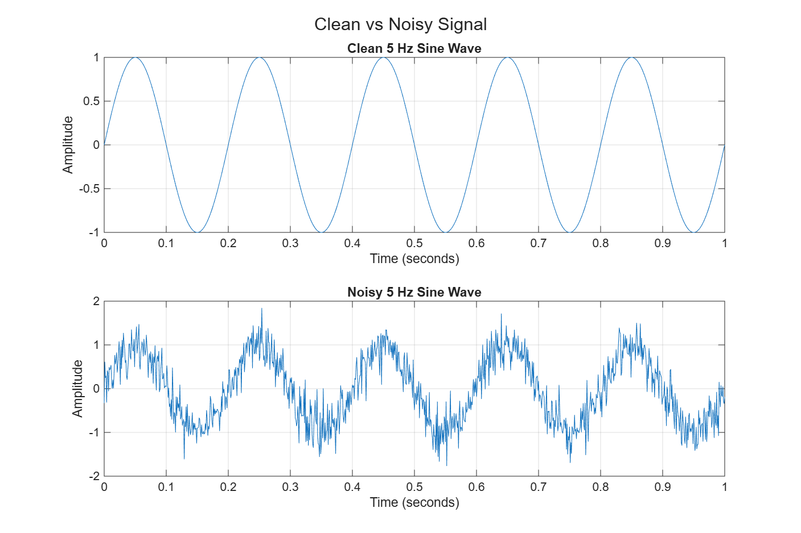

# Lecture 01 – Signal Visualization

## Objective

In this assignment I used MATLAB to generate simple sine signals and look at them in the time domain. I compared signals with different frequencies and amplitudes, added random noise to a clean signal, and saved the figures as PNG files.

Files in this folder:

| File | Content |
|---|---|
| `Lecture01_signal_visualization.m` | MATLAB script for Tasks 1–5 |
| `frequency_comparison.png` | 2 Hz, 5 Hz and 10 Hz sine waves |
| `amplitude_comparison.png` | Amplitudes 0.5, 1 and 2 at 5 Hz |
| `clean_vs_noisy_signal.png` | Clean and noisy 5 Hz sine wave |

## Task 1: Create a Sine Wave

The signal is `x = A*sin(2*pi*f*t)` with amplitude 1, frequency 5 Hz and a duration of 1 second. The time step is 1 ms, so the plot shows five full cycles as a smooth curve. The figure has a title, axis labels and a grid.

## Task 2: Compare Different Frequencies

**1. Which signal changes fastest?**
The 10 Hz signal. It goes up and down ten times in one second, so its slope is the steepest.

**2. Which signal has the lowest frequency?**
The 2 Hz signal. It completes only two cycles in one second.

**3. How can you see the difference in the plots?**
All three plots have the same time axis (0 to 1 s), so I can count the cycles: 2, 5 and 10. A higher frequency gives more cycles and a shorter period (0.5 s, 0.2 s and 0.1 s). The height of the waves is the same in all three plots.

## Task 3: Compare Different Amplitudes

All three signals use 5 Hz.

**1. Which signal has the largest amplitude?**
The signal with amplitude 2. Its peaks reach +2 and −2.

**2. Does changing amplitude change frequency?**
No. All three signals still have five cycles in one second and cross zero at the same times. Only the height of the wave changes.

**3. Give one real-world example where amplitude is important.**
In audio, amplitude is related to loudness. If the amplitude of a microphone or speaker signal is too large, the amplifier clips and the sound is distorted.

## Task 4: Add Noise

The noisy signal is the clean 5 Hz sine wave plus `0.3*randn(size(t))`.

**1. What changed after adding noise?**
The curve is no longer smooth. Every sample is moved up or down by a small random value, so the line looks rough and the peaks are sometimes higher than 1.

**2. Can you still recognize the original signal?**
Yes. The noise is smaller than the signal, so the five cycles and the overall sine shape are still clear.

**3. Give one real-world source of signal noise.**
Electrical interference, for example 50 Hz mains hum picked up by sensor cables. Thermal noise in resistors and amplifiers is another source.

## Task 5: Save Figures

The script saves the three figures with `saveas(gcf, ...)`:

- `frequency_comparison.png`
- `amplitude_comparison.png`
- `clean_vs_noisy_signal.png`

## Task 6: Use AI Responsibly

**AI Tool Used:** Claude

**Prompt:** "Explain how to plot several sine waves with `subplot` in MATLAB and how to save a figure as a PNG file."

**What AI Suggested:** AI was used for learning. It explained how `subplot(3,1,k)` places several plots in one figure, how `randn` creates random noise, and that `saveas(gcf, 'name.png')` saves the current figure.

**Did the code work immediately?** Yes, the script ran without errors.

**What did you modify?** I used a loop for the three frequencies and the three amplitudes, and I checked that the titles, labels and file names match the assignment.

**How did you verify the result?** I counted the cycles in each plot (2, 5 and 10 in one second), checked that the peaks are at 0.5, 1 and 2 in the amplitude figure, and checked that the three PNG files were created.
