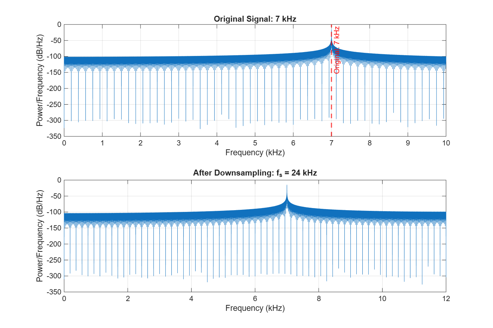
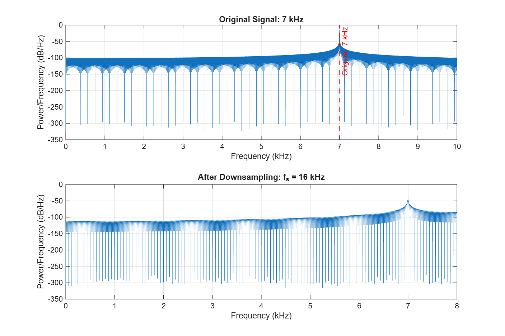
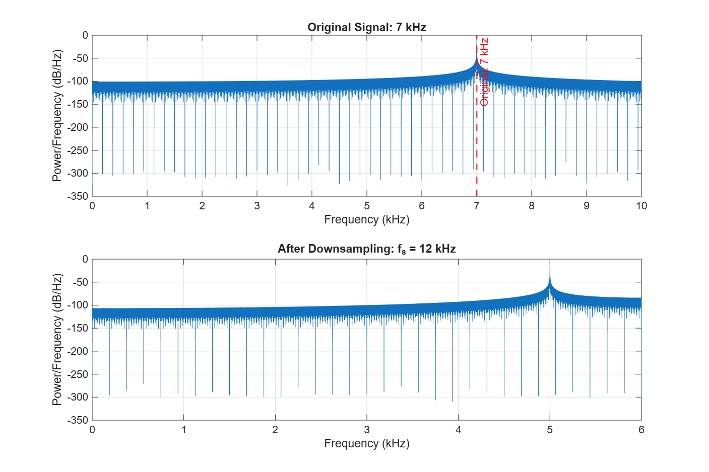
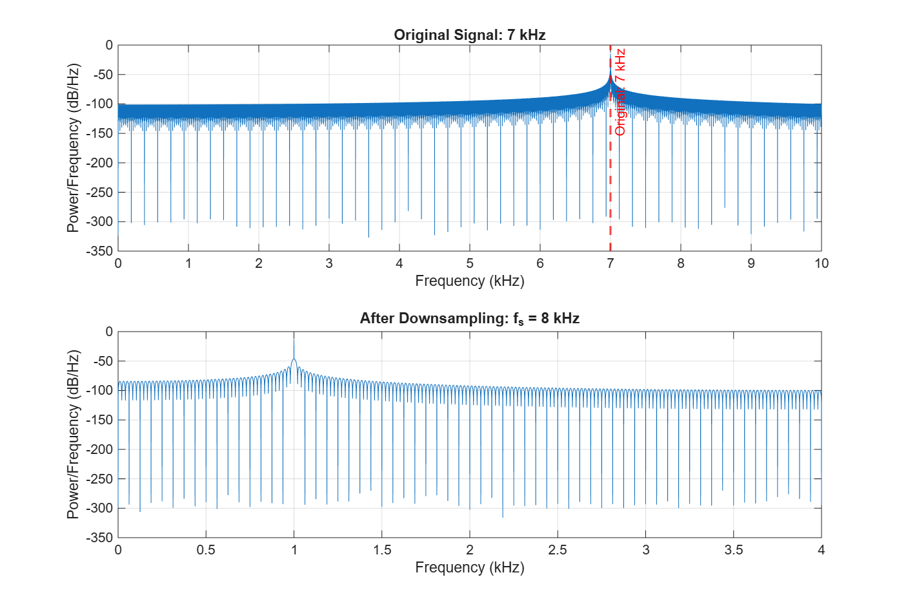

# Hearing and Seeing Aliasing – 7 kHz Audio Experiment

## Purpose

A 7 kHz tone is created at 48 kHz and then downsampled without an anti-aliasing filter. I ran `AliasingExperiment.m` four times, changing only `fs_low`, and compared the spectrum and the sound each time.

## Results

| Sampling frequency | Nyquist frequency | Observed peak | Aliasing |
|---|---:|---:|---|
| 24 kHz | 12 kHz | 7 kHz | No |
| 16 kHz | 8 kHz | 7 kHz | No |
| 12 kHz | 6 kHz | 5 kHz | Yes |
| 8 kHz | 4 kHz | 1 kHz | Yes |

The alias frequencies agree with the calculation |f − f_s|:

- 12 kHz: |7 − 12| = 5 kHz
- 8 kHz: |7 − 8| = 1 kHz

Spectrum figures saved by the script:

| f_s | Figure |
|---|---|
| 24 kHz |  |
| 16 kHz |  |
| 12 kHz |  |
| 8 kHz |  |

## Questions

**1. Which sampling frequencies represented the 7 kHz signal correctly?**
24 kHz and 16 kHz. Their Nyquist frequencies (12 kHz and 8 kHz) are above 7 kHz, so the peak stays at 7 kHz.

**2. When did the 7 kHz signal appear as another frequency?**
At 12 kHz the peak moved to 5 kHz, and at 8 kHz it moved to 1 kHz.

**3. What happened when the Nyquist frequency became lower than 7 kHz?**
The tone could not be represented any more. It folded back around the Nyquist frequency and appeared as a lower tone inside the range 0 to f_s/2. The 7 kHz component itself is gone from the spectrum.

**4. Did the aliased signal sound different?**
Yes. At 24 kHz and 16 kHz the tone sounds the same as the original. At 12 kHz the pitch is a little lower (5 kHz). At 8 kHz the change is very clear: the sharp 7 kHz tone becomes a much lower 1 kHz tone.

## Conclusion

A 7 kHz tone needs a sampling frequency above 14 kHz. Below that, the samples of the 7 kHz tone are identical to the samples of a lower tone, so the original frequency cannot be recovered afterwards. This is why a low-pass (anti-aliasing) filter must be used before downsampling.

## AI Usage

AI (Claude) was used for learning: to understand how the alias frequency is calculated and what `periodogram` shows.
