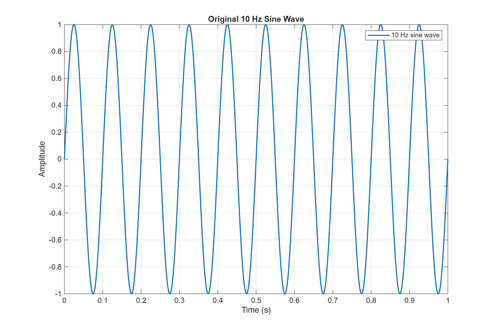
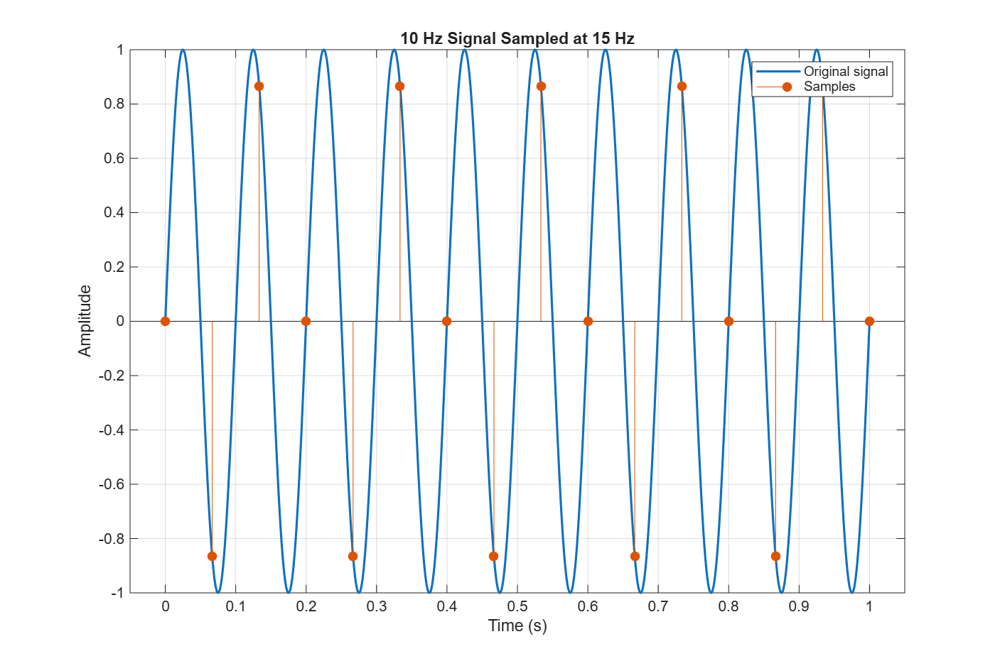
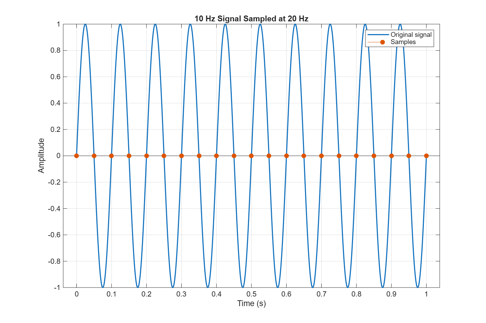
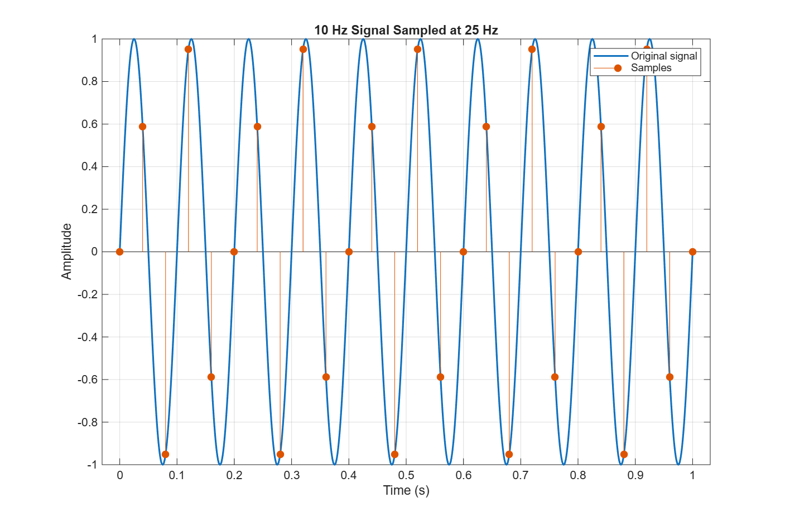
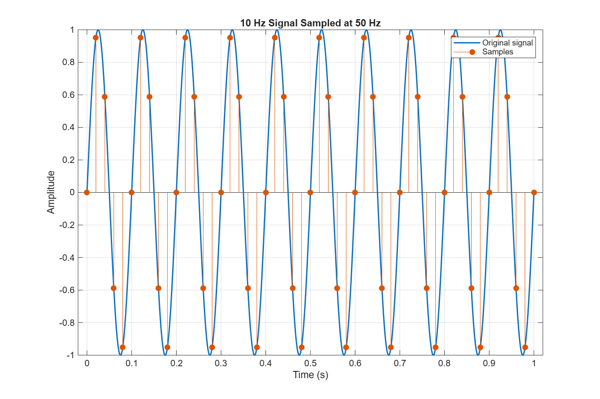
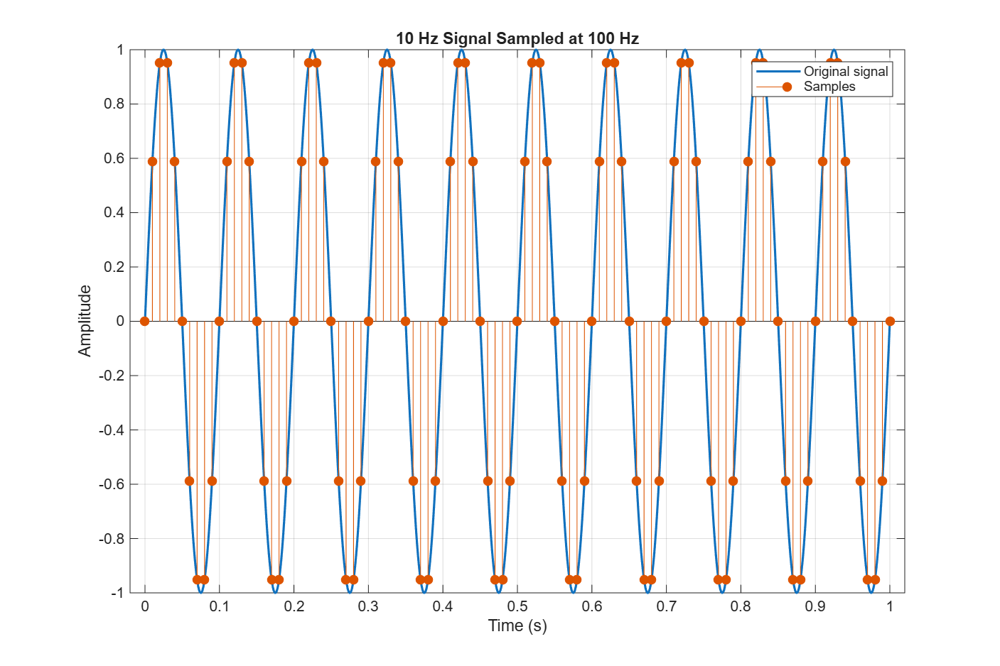

# Lecture 02 – Sampling and Aliasing

## Objective

A vibration sensor gives an analog signal that has to be sampled before MATLAB or an AI algorithm can use it. In this investigation I sampled a 10 Hz sine wave at 15, 20, 25, 50 and 100 Hz to see how the sampling frequency changes the digital picture of the signal, and to choose a sampling frequency that would work in a real system.

## Nyquist Analysis

The highest frequency in the signal is

f_max = 10 Hz

The Nyquist Sampling Theorem requires

f_s > 2 · f_max = 2 · 10 Hz = 20 Hz

So the Nyquist rate is 20 Hz, and the sampling frequency has to be higher than that.

| Sampling frequency | Compared with 20 Hz | Samples per cycle | Nyquist criterion |
|---:|---|---:|---|
| 15 Hz | below | 1.5 | Not satisfied |
| 20 Hz | equal | 2 | Not satisfied (limit case) |
| 25 Hz | above | 2.5 | Satisfied |
| 50 Hz | above | 5 | Satisfied |
| 100 Hz | above | 10 | Satisfied |

**1. Which sampling frequencies satisfy the Nyquist criterion?**
25 Hz, 50 Hz and 100 Hz.

**2. Is sampling exactly at the Nyquist rate recommended in practice?**
No. With exactly two samples per cycle the result depends on the phase. In my script the 10 Hz sine starts at zero, so at 20 Hz every sample lands on a zero crossing (sin(π·k) = 0) and the sampled signal looks like a flat line. Real signals also contain noise and harmonics above the wanted frequency, and a real anti-aliasing filter needs some room to roll off, so a margin above the Nyquist rate is needed.

## Results

The original signal has ten cycles in one second.

**15 Hz** – Only 1.5 samples per cycle. The samples do not follow the 10 Hz curve. They fit a slower wave of |10 − 15| = 5 Hz, which is the alias.

**20 Hz** – Two samples per cycle, but all of them fall on the zero crossings, so the sampled values are all (almost) zero and the signal disappears.

**25 Hz** – The criterion is satisfied, and the frequency is kept, but 2.5 samples per cycle is too few to see the sine shape. The sample heights change from cycle to cycle.

**50 Hz** – Five samples per cycle. The samples follow the curve, and the shape and amplitude are easy to recognise.

**100 Hz** – Ten samples per cycle. The samples trace the curve closely, at the cost of twice as much data as 50 Hz.

## Aliasing Discussion

Aliasing occurs at 15 Hz, because 15 Hz is below the Nyquist rate of 20 Hz. The sampled points describe a 5 Hz wave, not the real 10 Hz signal. At 20 Hz the signal is also not represented correctly: the samples hit only the zero crossings, so the result is a flat line.

Aliasing happens because the sampler takes fewer than two samples per cycle. The signal changes between two samples more than the samples can show, so a fast signal and a slower one give exactly the same sample values. After sampling there is no way to tell them apart.

For a real system I recommend 100 Hz. It gives ten samples per cycle, so the amplitude and shape of the 10 Hz vibration are accurate. It also leaves a wide gap between the signal (10 Hz) and the Nyquist frequency (50 Hz), so an anti-aliasing filter can remove noise and harmonics before they fold back. The data rate is still very small for any microcontroller. If memory or power is very limited, 50 Hz is the lowest value I would accept. 25 Hz is valid in theory but too close to the limit to be robust.

## Engineering Recommendation

Use **100 Hz** with an analog anti-aliasing low-pass filter before the ADC. It is five times the Nyquist rate, gives ten samples per cycle and costs very little processing. 50 Hz is an acceptable low-power alternative. In a real condition-monitoring system the final value should be based on the highest vibration frequency that must be detected, which is usually well above the basic rotation frequency.

## AI Usage

- **AI Tool Used:** Claude
- **Prompt(s):** "Explain aliasing and the Nyquist Sampling Theorem with a 10 Hz sine wave example, and how to overlay sampled points on a signal in MATLAB."
- **Summary of AI Response:** AI was used for learning. It explained that the sampling frequency must be more than twice the highest signal frequency, that a signal sampled too slowly appears at a lower alias frequency, and that `stem` can be drawn over `plot` with `hold on`.
- **What I Modified:** I put the five sampling frequencies in a loop, added a printout of the sampling period and samples per cycle, and used the file names required by the assignment.
- **How I Verified the Results:** I calculated the Nyquist rate by hand (2 · 10 = 20 Hz), calculated the alias for 15 Hz (|10 − 15| = 5 Hz) and compared it with the figure, checked by hand that sin(π·k) = 0 explains the flat 20 Hz result, and checked that all six PNG files were created.
