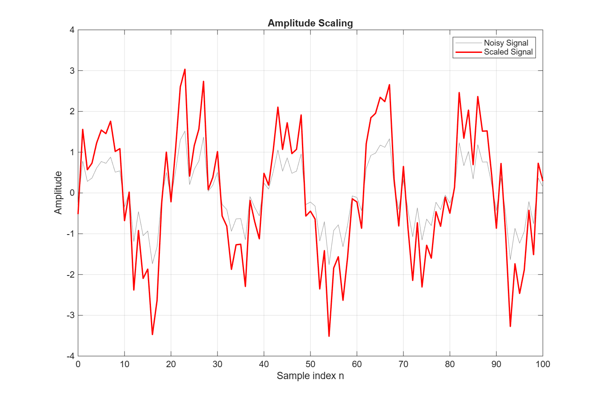
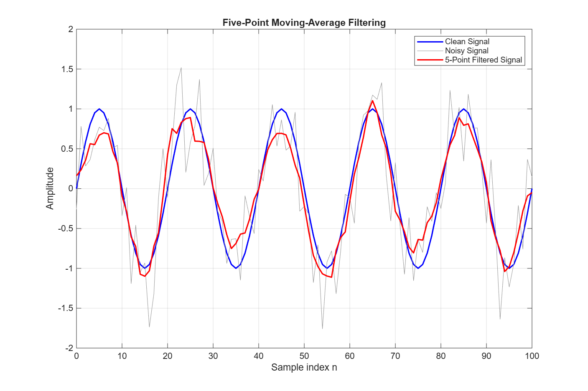
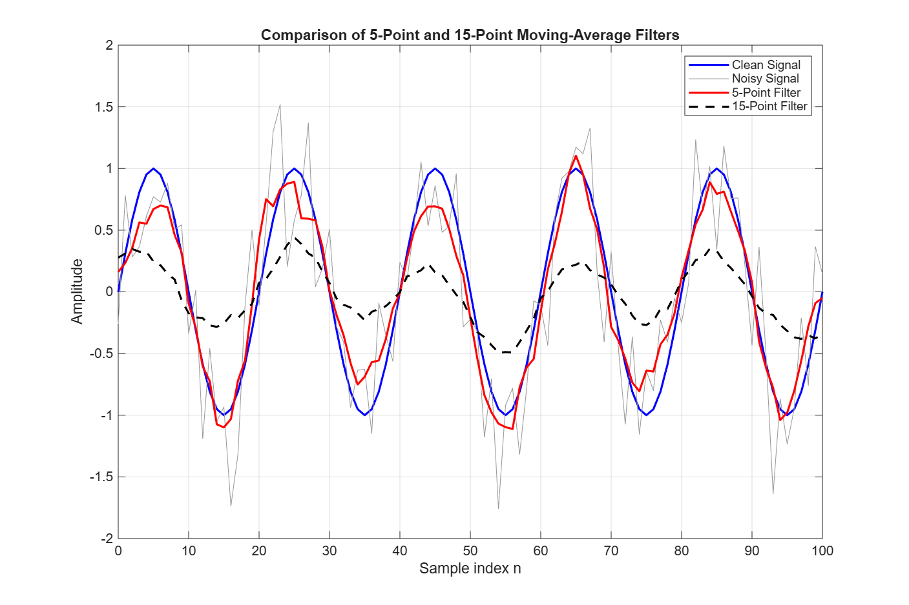

# Lecture 03 – Discrete-Time Signal Operations and Convolution

## Purpose

A clean discrete-time sine signal `sin(0.1*pi*n)` (n = 0…100) is mixed with random noise. The script scales and delays the noisy signal, and then uses convolution with 5-point and 15-point moving-average filters to reduce the noise.

Files: `Lecture03_convolution.m`, `signal_operations.png`, `noise_filtering.png`, `filter_comparison.png`.

## Figures

**Amplitude scaling**

**Five-point moving average**

**5-point and 15-point filters**

## README Questions

### 1. Which operation changed the signal amplitude?

Amplitude scaling: `scaled = 2 * measured`. In `signal_operations.png` every peak of the red curve is twice as high as the grey noisy signal, so the range grows from about −1.8…+1.5 to about −3.5…+3.0. The peaks and zero crossings stay at the same sample indices, so the frequency and the sample positions did not change. The noise is doubled as well, because it is part of the signal that is multiplied.

### 2. How did the five-sample delay change the signal?

The delay was made with `delayed = [zeros(1,5), measured]`. The whole signal moves five samples to the right on the n axis: the value that was at n = 0 is now at n = 5. The shape is the same, but the delayed signal starts with five zeros and is five samples longer (106 samples). In a real system a delay comes from processing time, a filter, or the travel time of the signal through a cable or the air.

### 3. What does the impulse response h[n] represent?

h[n] is the output of the system when the input is a single impulse δ[n]. It fully describes an LTI system, because the output for any input is the convolution of the input with h[n]. Here `h5 = [0.2 0.2 0.2 0.2 0.2]`, which means each output sample is built from five neighbouring input samples with an equal weight of 1/5. The weights add up to 1, so a constant level passes through unchanged.

### 4. How did convolution change the noisy signal?

`conv(measured, h5, 'same')` slides the five weights along the signal and replaces each sample with the average of itself and its neighbours. The noise is random and changes sign from sample to sample, so it mostly cancels in the average. The sine wave changes slowly, so it mostly survives. In `noise_filtering.png` the red curve is much smoother than the grey noisy signal and lies close to the blue clean signal.

### 5. What differences did you observe between the 5-point and 15-point filters?

The 5-point output (red) still has small bumps, but it follows the clean sine wave and its peaks are between about 0.7 and 1.1. The 15-point output (black dashed) is very smooth, but it is much smaller: its peaks stay below 0.5, while the clean signal reaches 1. Both curves also drop near n = 0 and n = 100, because `'same'` treats the samples outside the signal as zeros.

### 6. Which filter removed more noise?

The 15-point filter. Averaging N independent noise samples reduces the noise variance by a factor of N, so 15 points remove more of the fast variation than 5 points. The black dashed curve has almost no sample-to-sample jitter.

### 7. Did the longer filter remove or distort useful signal information?

Yes. The clean sine has a period of 20 samples. A 15-sample window covers three quarters of a period, so positive and negative parts of the sine are averaged together and cancel. The gain of a moving average at this frequency (ω = 0.1π) is

- 5-point: sin(5·0.05π) / (5·sin(0.05π)) ≈ 0.90
- 15-point: sin(15·0.05π) / (15·sin(0.05π)) ≈ 0.30

This matches the figure: the 15-point output keeps only about 30 % of the sine amplitude. The noise is gone, but so is most of the useful signal.

The RMSE against the clean signal, printed at the end of the script (edges left out), shows the same thing:

| Signal | RMSE |
|---|---:|
| Noisy signal | 0.401 |
| 5-point filter | 0.183 |
| 15-point filter | 0.507 |

The 5-point filter cuts the error to less than half. The 15-point filter is further from the clean signal than the unfiltered noisy signal, because of the lost amplitude.

### 8. Which filter would you recommend for this signal?

The 5-point filter. It has the lowest error (RMSE 0.183), removes a clear part of the noise and still keeps about 90 % of the sine amplitude, and its shape and timing agree with the clean signal. The 15-point filter is too long compared with the 20-sample period of the signal. A longer filter would only be a good choice if the wanted signal changed much more slowly.

### 9. One real engineering application

Smoothing sensor readings in an embedded system, for example a temperature or battery-voltage measurement read by a microcontroller ADC. A short moving average removes random jitter before the value is shown on a display or used by a controller.

## AI Usage

Tool used: Claude

How I used it: AI was used for learning. I used it to understand what `conv(...,'same')` does and why a long moving average lowers the amplitude of a sine wave.

What I verified or changed: I ran the script and compared the figures with the explanation. I calculated the moving-average gain for 5 and 15 points by hand (0.90 and 0.30) and checked that the amplitudes in `filter_comparison.png` agree. I added an RMSE printout at the end of the script as a numerical check.
