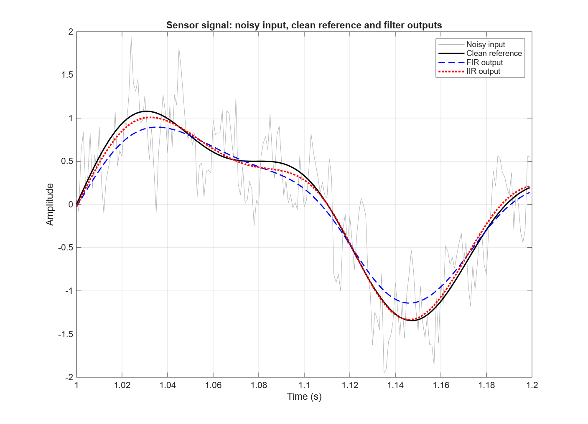
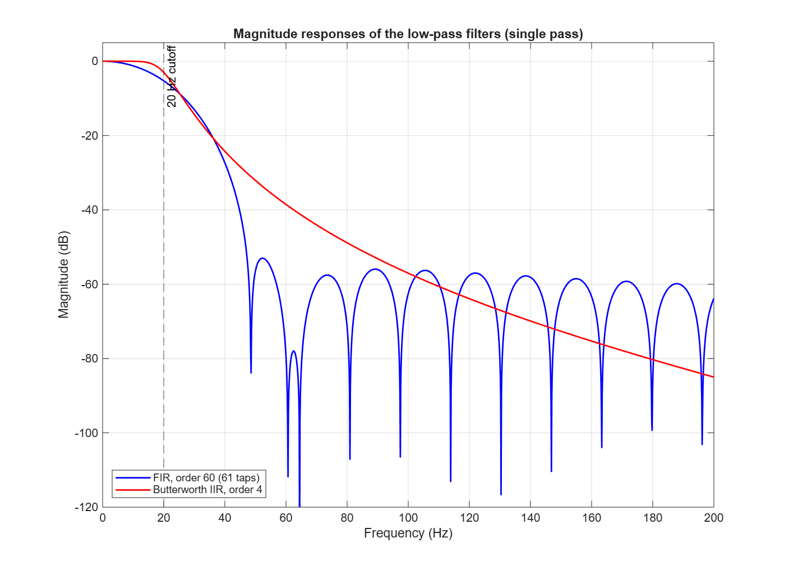
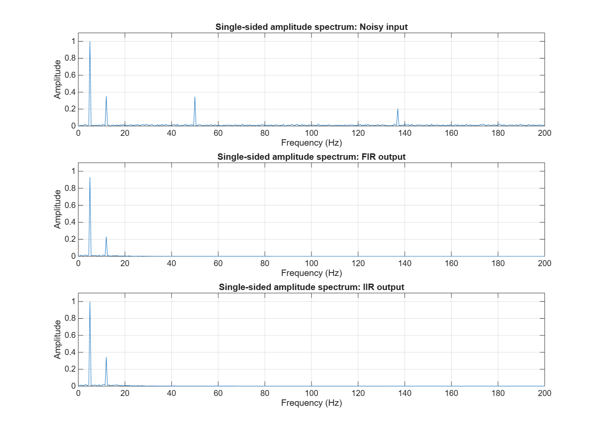
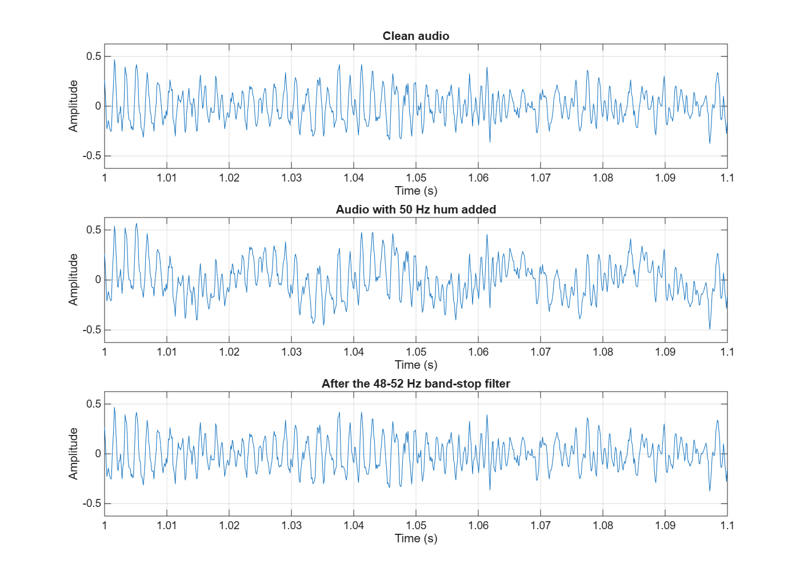
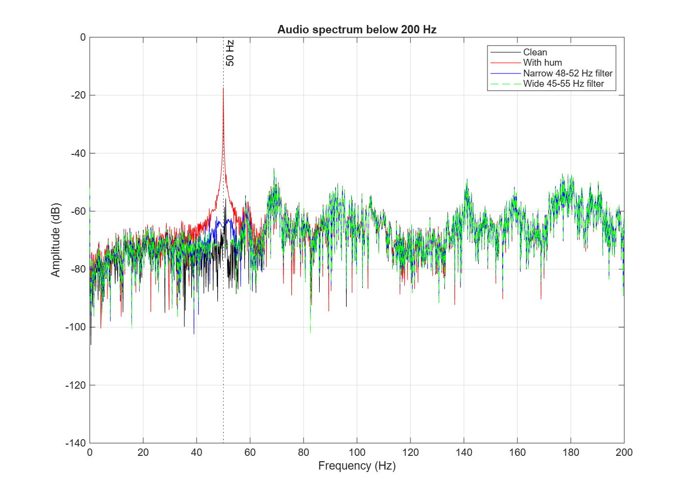
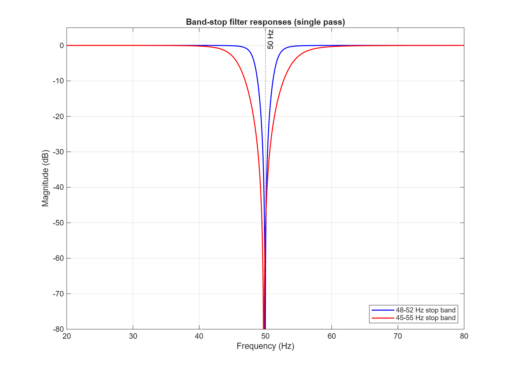

# Lecture 06 – Digital Filter Design: Sensor Signal and 50 Hz Audio Hum

Md Mohiuddin Mollah – Digital Signal Processing 2026

This report covers two filtering tasks. In Part A a synthetic sensor signal with a known clean reference is low-pass filtered with an FIR and an IIR filter. In Part B a controlled 50 Hz hum is added to an audio recording and removed with a narrow band-stop filter.

## Tools and files

- MATLAB R2026b (26.2.0, Update 2), MATLAB Online
- Signal Processing Toolbox: available (`fir1`, `butter`, `freqz`, `filtfilt`)

| File | Content |
|---|---|
| `filter_assignment.m` | Runnable script for Part A and Part B |
| `sensor_time_comparison.png` | Clean, noisy, FIR and IIR signals over 0.2 s |
| `sensor_frequency_responses.png` | Magnitude responses of the two low-pass filters |
| `sensor_spectra.png` | Amplitude spectra of the noisy input and both outputs |
| `audio_waveform_comparison.png` | Audio waveform: clean, with hum, filtered |
| `audio_spectrum.png` | Audio spectrum below 200 Hz |
| `notch_response.png` | Responses of the narrow and the wide band-stop filter |

To reproduce: open `filter_assignment.m` in MATLAB and press Run. The script prints all numbers used in this report and saves the six figures. Set `playAudio = true` at the top to hear the hum-added and the filtered audio at the same playback gain. No audio files are submitted; the script uses MATLAB's built-in `handel` recording.

---

## Part A – Filter a sensor signal

### Signal and filters

The signal is two seconds long and sampled at Fs = 1000 Hz. The wanted measurement is a 5 Hz component (amplitude 1) plus a smaller 12 Hz component (amplitude 0.35). The disturbance is 50 Hz interference (0.35), 137 Hz interference (0.20) and random noise (standard deviation 0.25, `rng(7)`).

Both filters are low-pass filters with a 20 Hz cutoff:

- FIR: `fir1(60, 20/(Fs/2))`, order 60, 61 coefficients
- IIR: `butter(4, 20/(Fs/2))`, 4th-order Butterworth, 5 + 5 coefficients

Both are applied with `filtfilt`. This runs the filter forwards and backwards, so there is no phase delay and the magnitude response is applied twice. It is an offline comparison, not a streaming implementation.

### Time-domain result

The grey noisy input jumps around the black clean reference. Both outputs are smooth. The IIR output (red, dotted) lies almost on top of the clean signal. The FIR output (blue, dashed) follows the slow 5 Hz shape but is too low at the peaks: around t = 1.03 s it reaches about 0.9 where the clean signal is about 1.08, and the small bend at t = 1.08 s caused by the 12 Hz component is flattened.

### Magnitude responses

The 20 Hz cutoff is marked with the dashed line. Single-pass gains from `freqz` (with `filtfilt` the dB values are doubled):

| Frequency | FIR (order 60) | IIR (Butterworth 4) |
|---:|---:|---:|
| 5 Hz | −0.31 dB | −0.00 dB |
| 12 Hz | −1.81 dB | −0.07 dB |
| 20 Hz (cutoff) | −5.27 dB | −3.01 dB |
| 50 Hz | −56.43 dB | −32.08 dB |
| 137 Hz | −58.12 dB | −69.05 dB |

The Butterworth filter is flat up to about 15 Hz and then rolls off smoothly without ripple. The FIR filter already starts to fall below 10 Hz, drops quickly between 30 and 50 Hz, and then has stop-band lobes at about −55 to −60 dB. With only 61 taps at a 1000 Hz sample rate the FIR transition band is wide, so it reaches into the wanted band.

### Spectra

Amplitudes read from the single-sided spectrum (bin spacing 0.5 Hz, so all four frequencies are exactly on a bin):

| Signal | 5 Hz | 12 Hz | 50 Hz | 137 Hz |
|---|---:|---:|---:|---:|
| Noisy input | 0.9991 | 0.3497 | 0.3458 | 0.2047 |
| FIR output | 0.9303 | 0.2298 | 0.0004 | 0.0001 |
| IIR output | 0.9988 | 0.3432 | 0.0014 | 0.0004 |

- **5 Hz:** kept by both filters. The FIR loses about 7 % of the amplitude, the IIR almost nothing.
- **12 Hz:** kept by the IIR (0.343 of 0.350). The FIR reduces it to 0.230, a loss of about one third. This is useful signal that is removed.
- **50 Hz and 137 Hz:** removed by both filters. The remaining amplitudes are below 0.002, which is at the level of the noise floor.

### RMSE against the clean signal

| Signal | Whole signal | Middle (0.2–1.8 s) | First 0.1 s |
|---|---:|---:|---:|
| Noisy input | 0.3801 | 0.3776 | 0.3985 |
| FIR output | 0.1056 | 0.1060 | 0.1135 |
| IIR output | 0.0548 | 0.0460 | 0.0722 |

RMSE is the typical distance between a signal and the clean reference, in the same units as the signal. Both filters lower it clearly: the FIR to about 28 % and the IIR to about 14 % of the unfiltered value.

What RMSE can tell: how close the output is to the reference on average. What it cannot tell: where the error comes from. The same RMSE could be caused by leftover noise, by lost amplitude or by a time shift. Here the spectra show that the FIR error is mostly the missing 12 Hz amplitude and not leftover interference. RMSE also needs a known clean signal, which a real measurement does not have.

### Comparison of the two designs

| Property | FIR, order 60 | Butterworth IIR, order 4 |
|---|---|---|
| Coefficients | 61 | 10 (5 + 5) |
| Pass band (5 and 12 Hz) | Already attenuates 12 Hz | Flat |
| Transition | Starts early, then steep after 30 Hz | Starts at the cutoff, smooth |
| 50 Hz interference | −56 dB (stronger) | −32 dB |
| 137 Hz interference | −58 dB | −69 dB (stronger) |
| Edge effects | Small (0.114 at the start compared with 0.106 in the middle) | More visible (0.072 at the start compared with 0.046 in the middle) |
| Phase when run causally | Linear, constant delay of 30 samples | Non-linear, frequency-dependent delay |

Both outputs have a larger error in the first 0.1 s than in the middle, because the filter has no earlier samples to work with at the edges. `filtfilt` reduces this by extending the signal, but it does not remove it. The effect is relatively larger for the IIR filter.

I would prefer the **IIR filter** for this offline task and in any small embedded system, because it gives a lower error with only 10 coefficients. I would prefer an **FIR filter** when the waveform shape must be kept in a real-time system (for example when the timing between sensor channels matters), because its linear phase delays all frequencies by the same amount. In that case it needs more taps than 61 to protect the 12 Hz component.

---

## Part B – Reduce a 50 Hz hum in audio

### Signal and filter

The recording is MATLAB's `handel` example: Fs = 8192 Hz, 8.92 s, mono. Fs is far above 102 Hz, so a 50 Hz component can be represented. A hum of `0.15*sin(2*pi*50*t)` is added, so the clean signal is known.

The filter is a 2nd-order Butterworth band-stop, `butter(2, [48 52]/(Fs/2), 'stop')`, applied with `filtfilt`. The normalized edges are 0.0117 and 0.0127, well below 1. A second filter with a 45–55 Hz stop band is used for comparison.

### Waveform

All three plots use the same axes. In the middle plot the audio rides on a slow wave with a period of 20 ms (50 Hz): the whole waveform is pushed up and down. After the filter this slow wave is gone, and the bottom plot looks the same as the clean audio in the top plot.

### Spectrum

The red curve (with hum) has a sharp peak at 50 Hz that stands about 40 dB above the audio content around it. After filtering, the peak is gone and the curves follow the clean spectrum again. Above about 60 Hz all four curves lie on top of each other, so the rest of the audio is not changed.

### 50 Hz measurement

Measurement method: the signal is multiplied by a 50 Hz complex exponential and averaged over the whole recording, `2*abs(mean(s .* exp(-1j*2*pi*50*t)))`. This gives the amplitude of the 50 Hz component directly and does not depend on the FFT bin positions.

| Signal | 50 Hz amplitude | RMSE against clean audio |
|---|---:|---:|
| Clean audio | 0.00038 | – |
| With hum | 0.15020 | 0.10606 |
| Narrow filter (48–52 Hz) | 0.00054 | 0.00405 |
| Wide filter (45–55 Hz) | 0.00024 | 0.00332 |

The hum amplitude drops from 0.150 to 0.0005 with the narrow filter, a measured reduction of **48.9 dB** (55.8 dB with the wide filter). The remaining value is about as small as the 50 Hz content of the clean music itself (0.0004), so the measurement cannot show a larger reduction than this. The filter response at 50 Hz is −68 dB in one pass for the narrow filter, so the filter itself is not the limit.

### Listening

The script plays the hum-added and the filtered signal with the same gain when `playAudio = true`. Based on the measurements, the low buzz should disappear, and the choir should sound unchanged, because the music has very little energy near 50 Hz and nothing above 60 Hz is touched. **[Listen once and replace this paragraph with what you actually hear.]**

### Narrow and wide stop band

| Frequency | Narrow (48–52 Hz) | Wide (45–55 Hz) |
|---:|---:|---:|
| 40 Hz | −0.00 dB | −0.19 dB |
| 45 Hz | −0.09 dB | −3.01 dB |
| 48 Hz | −3.01 dB | −18.00 dB |
| 50 Hz | −67.97 dB | −52.05 dB |
| 52 Hz | −3.01 dB | −14.41 dB |
| 55 Hz | −0.13 dB | −3.01 dB |
| 60 Hz | −0.01 dB | −0.34 dB |

The wide filter still attenuates strongly at 48 and 52 Hz, so it would keep working if the hum frequency moved by a hertz or two. The narrow filter only gives −3 dB there. The price is that the wide filter removes more of the real sound: when the clean audio alone is passed through each filter, the RMS of the removed part is 0.00185 for the narrow filter and 0.00227 for the wide one, about 23 % more. For this recording both values are small because a choir has little content near 50 Hz. For a bass guitar or a kick drum the loss would be audible.

The wide filter has a slightly lower RMSE here (0.00332 compared with 0.00405). The reason is the edges: a narrower filter rings for a longer time, so a little hum is left at the very start and end of the recording. This is a trade-off of narrow filters and should not be read as "wide is better".

---

## Report questions

**1. Why is a 20 Hz low-pass reasonable for Part A, and what assumption does it make?**
The wanted components are at 5 and 12 Hz and the nearest interference is at 50 Hz. A 20 Hz cutoff lies between them, with room on both sides. The assumption is that everything the sensor should measure is below 20 Hz. If the real process had useful content above that, for example a fast transient or a harmonic at 30 Hz, the filter would remove it together with the noise. Random noise below 20 Hz also stays in the output.

**2. Which filter gives the better result?**
The IIR filter, for the requirement "keep the 5 and 12 Hz components and reduce the interference". Two kinds of evidence: (1) the RMSE is 0.055 for the IIR and 0.106 for the FIR; (2) in the spectrum the IIR keeps the 12 Hz amplitude at 0.343 of 0.350, while the FIR reduces it to 0.230. The frequency response explains this: the FIR is already at −1.8 dB at 12 Hz. The FIR does remove the 50 Hz interference more strongly, but both filters bring it below 0.002, so that advantage does not matter here.

**3. How would the implementation change for live filtering with low latency?**
`filtfilt` cannot be used, because it needs the whole recording and runs backwards in time. A live system would use the causal `filter` function, sample by sample, and keep the filter state between samples. Then the delay matters. The 61-tap FIR delays every frequency by 30 samples (30 ms at 1000 Hz). The 4th-order IIR has a shorter delay in the pass band and needs only 10 coefficients, but its delay depends on frequency, so the waveform shape is slightly changed. For low latency I would use the IIR filter or a shorter FIR, and accept less attenuation because the response is applied only once.

**4. Why is a narrow band-stop appropriate for a steady 50 Hz hum, and what if the frequency drifted?**
A steady hum is a single frequency, so only a very small part of the spectrum has to be removed, and the audio next to it can be kept. If the mains frequency drifted, a fixed narrow filter would miss it (only −3 dB at 48 or 52 Hz). Options are a wider stop band, which costs more low-frequency sound, or better an adaptive notch that tracks the hum frequency, or subtracting a reference signal taken from the mains. Harmonics at 100 and 150 Hz would need their own notches.

**5. One limitation and one improvement.**
Limitation: both experiments use ideal, artificial disturbances. The hum is a perfect sine wave with a fixed amplitude and no harmonics, and the sensor interference is exactly on known frequencies. Real hum has harmonics and changes over time, and a real sensor has no clean reference for an RMSE. The audio was also not judged in a controlled listening test. Improvement: record real data with the interference present, and in the real system put an analog anti-aliasing filter in front of the ADC and use an adaptive or tracking notch, then judge the result by spectrum and by listening.

---

## AI usage

AI (Claude) was used for learning: to understand `filtfilt`, how `freqz` values relate to the filtered amplitudes, and how to measure a single frequency component. All numbers in this report are printed by `filter_assignment.m`.
