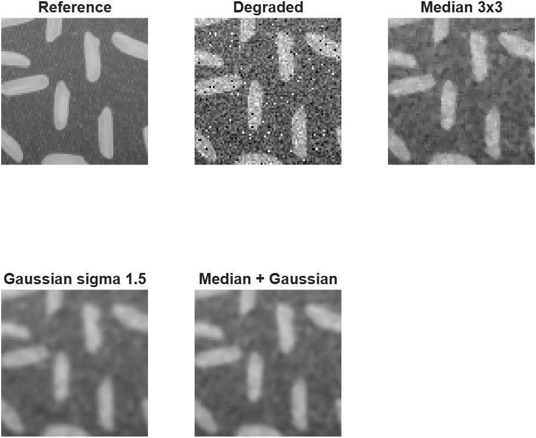

# Individual Assignment – Image Processing Fundamentals

Md Mohiuddin Mollah – Digital Signal Processing 2026

## Selected option

**Option A – Compare denoising filters**

Question: which of three filters restores a noisy copy of `rice.png` best, measured with PSNR and SSIM against the original image and checked by eye in a zoomed region?

## Image

| Image | Source | Use |
|---|---|---|
| `rice.png` | MATLAB sample image, Image Processing Toolbox (256 × 256, 8-bit grayscale) | Reference image `Iref` |

The image itself is not uploaded. It ships with the Image Processing Toolbox.

## Settings

| Step | Setting |
|---|---|
| Degradation | `rng(42); Id = imnoise(imnoise(Iref,'gaussian',0,0.01),'salt & pepper',0.02);` |
| Filter 1 | 3×3 median filter: `medfilt2(Id, [3 3])` |
| Filter 2 | Gaussian filter, sigma 1.5: `imgaussfilt(Id, 1.5)` |
| Filter 3 | 3×3 median filter, then Gaussian filter with sigma 1: `imgaussfilt(medfilt2(Id, [3 3]), 1)` |
| Metrics | `psnr` and `ssim` against `Iref` |
| Zoomed region | rows 101–180, columns 61–140 (80 × 80 pixels) |

All three filters use the same degraded image. No other setting is changed.

## Files

| File | Content |
|---|---|
| `analysis.mlx` | Executed MATLAB Live Script with code, outputs and written explanations |
| `analysis.pdf` | PDF export of the executed Live Script (readable on GitHub) |
| `results/metrics.csv` | PSNR and SSIM table |
| `results/median_3x3.png` | Processed image, filter 1 |
| `results/gaussian_sigma1_5.png` | Processed image, filter 2 |
| `results/median_then_gaussian.png` | Processed image, filter 3 |
| `results/comparison_full.png` | Degraded image and the three results |
| `results/comparison_zoom.png` | Zoomed region of the reference, degraded and filtered images |

## How to run

- MATLAB version: R2026b (26.2.0, Update 2), MATLAB Online
- Required: Image Processing Toolbox

1. Open `analysis.mlx` in MATLAB.
2. Press **Run** on the Live Editor tab.
3. The script recreates the `results` folder next to the Live Script. The noise is seeded with `rng(42)`, so the numbers are the same on every run.

## Results

| Image | PSNR (dB) | SSIM |
|---|---:|---:|
| Degraded (no filter) | 18.09 | 0.3696 |
| Median 3×3 | 25.37 | 0.6232 |
| Gaussian, sigma 1.5 | 25.75 | 0.6921 |
| Median 3×3 + Gaussian, sigma 1 | 26.37 | 0.7051 |

## Main conclusion

The median filter followed by a Gaussian filter gives the best result for this image, in both PSNR (26.37 dB) and SSIM (0.71). The median step removes the salt & pepper pixels, and a small Gaussian (sigma 1) is then enough for the remaining Gaussian noise. The median filter alone keeps sharp grain edges but leaves a grainy background. The Gaussian filter alone gives a smooth background but blurs the grain edges and only smears the impulse pixels.

## One limitation

The comparison uses one image, one noise realisation and one fixed setting per filter. The differences are small (1 dB between the best and the worst filter), so a different sigma, window size or noise level could change the ranking. PSNR and SSIM are also averages over the whole image and do not show where the errors are, which is why the zoomed region is needed.

## AI usage

AI (Claude) was used for learning: to understand what PSNR and SSIM measure and how the Live Script is structured. The numbers above are the outputs stored in the executed Live Script.
