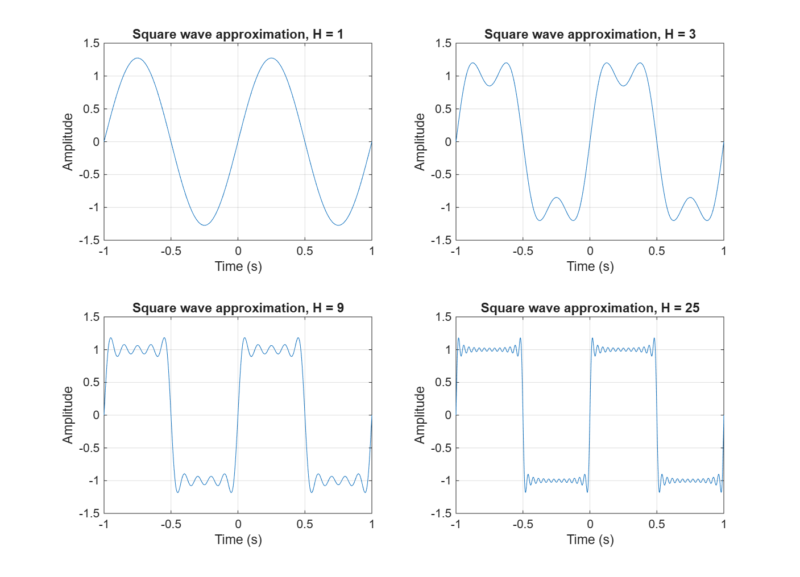
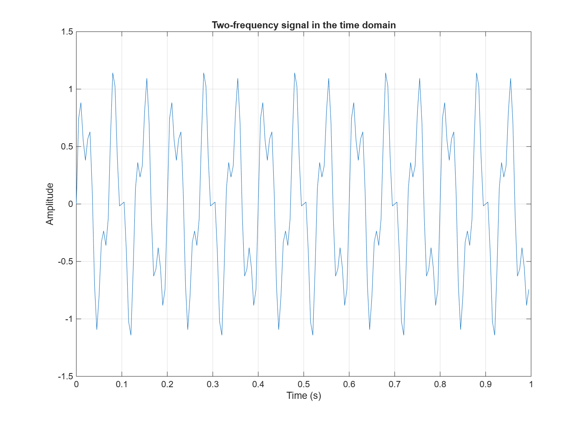
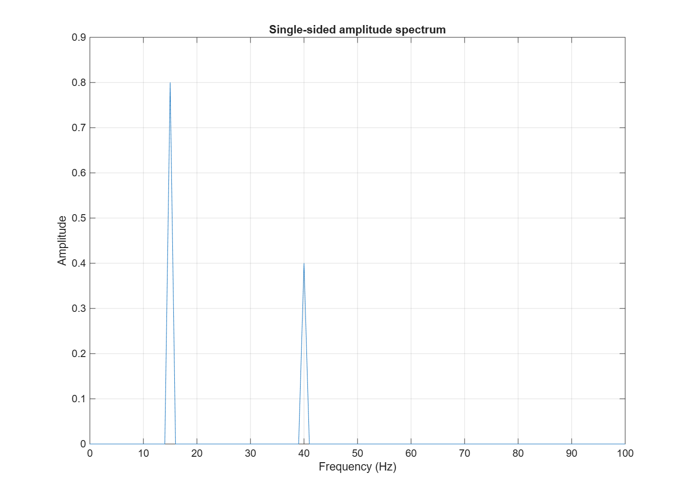
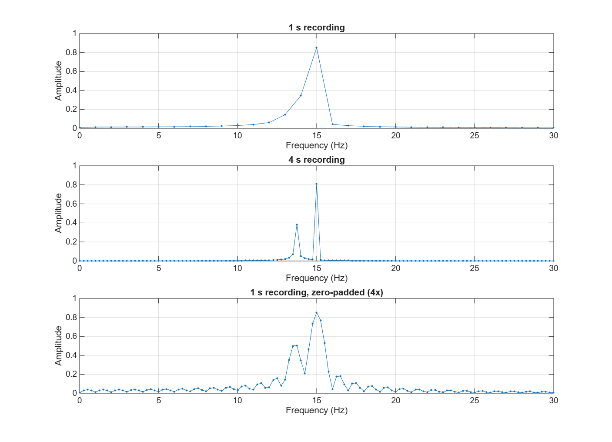
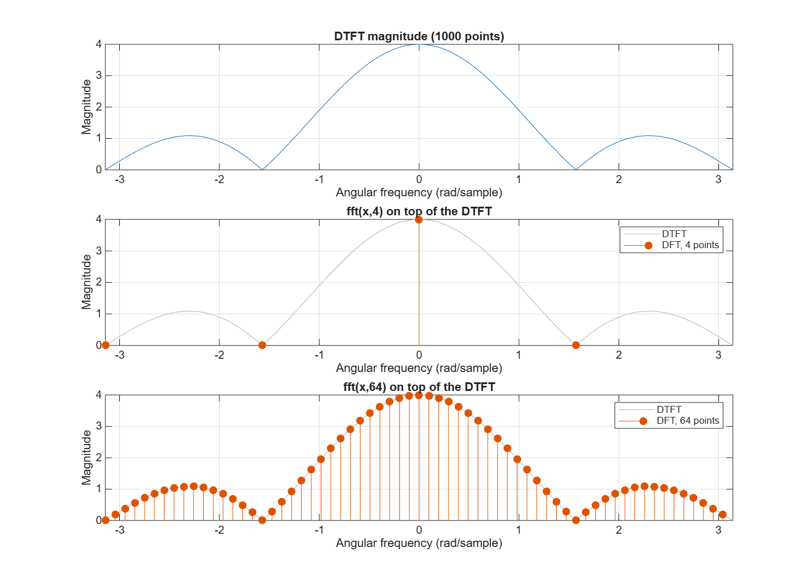

# Lecture 5 – Fourier Series, DTFT and DFT

MATLAB experiments on building a periodic signal from harmonics and on how the DFT shows the frequencies of a sampled signal.

```
lecture-5-fourier-assignment/
├── README.md
├── exercise-1/  exercise1.m, square-wave-comparison.png
├── exercise-2/  exercise2.m, two-frequency-signal.png, two-frequency-spectrum.png
├── exercise-3/  exercise3.m, leakage-comparison.png
└── exercise-4/  exercise4.m, dtft-dft-comparison.png
```

Last digit used in Exercise 3: **d = 3**

## AI-use note

AI (Claude) was used for learning: to understand MATLAB syntax (`fft` scaling, `subplot`, zero-padding with `fft(x, N)`) and to check my explanations. The numbers in this README are the values printed by the scripts.

---

## Exercise 1: Build a square wave from harmonics

**Prediction (before running):** With only H = 1 the result is a plain sine wave. Adding more odd harmonics should make the edges steeper and the top flatter, so the waveform should look more and more like a square wave between −1 and +1.



**Results:**

| H | Maximum value |
|---:|---:|
| 1 | 1.2732 |
| 3 | 1.2004 |
| 9 | 1.1823 |
| 25 | 1.1795 |

**What changes as H increases:** The transitions at t = 0 and t = ±0.5 become steeper, and the flat parts get closer to ±1. The ripple on the flat parts gets faster and smaller in the middle. For H = 1 the maximum is 4/π ≈ 1.27, because that is the amplitude of the first harmonic alone.

**Near the sharp transitions:** The prediction was only partly right. Next to every jump there is an overshoot that does not go away. The maximum stays near 1.18 for H = 9 and H = 25, which is about 18 % above the level 1 (about 9 % of the full jump from −1 to +1). More harmonics make the overshoot narrower and push it closer to the edge, but its height stays almost the same. This is the Gibbs phenomenon: a finite number of smooth sine waves cannot follow a jump exactly.

---

## Exercise 2: Find two frequencies with the FFT

**Expected (written down before running):**

| Component | Frequency | Amplitude |
|---|---:|---:|
| 1 | 15 Hz | 0.8 |
| 2 | 40 Hz | 0.4 |





**Measured:**

| Peak | Frequency | Amplitude |
|---|---:|---:|
| 1 | 15.00 Hz | 0.8000 |
| 2 | 40.00 Hz | 0.4000 |

The measured values are the same as the values used to create the signal.

**Bin spacing:**

N = fs · T = 200 · 1 = 200 samples

Δf = fs / N = 200 / 200 = 1 Hz (the same as 1/T)

**Why the peaks are clean:** In one second the 15 Hz sine completes exactly 15 cycles and the 40 Hz sine exactly 40 cycles. Both frequencies are whole multiples of the 1 Hz bin spacing, so each one falls exactly on a DFT bin and all of its energy lands in that one bin. In the time-domain plot the two components cannot be separated by eye, but the spectrum shows them directly.

---

## Exercise 3: Investigate spectral leakage

**d = 3**, so f2 = 13.2 + 0.17 · 3 = **13.71 Hz**

**Prediction (before running):** 13.71 Hz does not fit a whole number of cycles into one second, so it will not land on a 1 Hz bin. I expected the peak near f2 to be lower than 0.4 and spread over the neighbouring bins, with the 15 Hz peak still clear at 0.8.



**Measured:**

| Case | Bin spacing | Highest value near f2 | At frequency | True amplitude |
|---|---:|---:|---:|---:|
| 1 s recording | 1 Hz | 0.3446 | 14.00 Hz | 0.4 |
| 4 s recording | 0.25 Hz | 0.3834 | 13.75 Hz | 0.4 |
| 1 s, zero-padded 4× | 0.25 Hz (plot points) | 0.5029 | 13.75 Hz | 0.4 |

**1 s recording:** The prediction was right about the leakage, but the effect is stronger than I expected. There is no separate peak at f2 at all. The energy of the 13.71 Hz component is spread over the bins at 12, 13 and 14 Hz and forms a shoulder on the left side of the 15 Hz peak. With 1 Hz bins, two components that are only 1.29 Hz apart cannot be seen as two peaks.

**4 s recording:** The bin spacing is 1/T = 0.25 Hz. Now two separate, narrow peaks appear, one at 15 Hz and one at 13.75 Hz, which is the bin closest to 13.71 Hz. Its height is 0.38, close to the true 0.4. A little leakage is left because 13.71 Hz is still not exactly on a bin (13.71 · 4 = 54.84 cycles, not a whole number).

**Zero-padding:** The plot has the same 0.25 Hz point spacing as the 4 s case, but it looks different. The curve is smooth and shows a wide main lobe around 15 Hz with ripples (side lobes) on both sides, and a bump near 13.75 Hz. The bump is 0.50, which is higher than the true amplitude, because the side lobe of the strong 15 Hz component adds to the 13.71 Hz component there. The peaks are just as wide as in the 1 s case.

**Does zero-padding add information?** No. The padded zeros are not new measurements. Zero-padding only calculates more points on the same underlying spectrum of the 1-second recording, so it shows the shape between the bins. The real resolution is still set by the recording length (1/T = 1 Hz). Only the longer 4 s recording contains more information, and only that one separates the two components properly.

---

## Exercise 4: Compare the DTFT and the DFT



**Results:** `abs(fft(x,4))` = [4 0 0 0]. The DTFT magnitude has its maximum of 4 at ω = 0. The largest difference between `fft(x,64)` and the DTFT at the same frequencies is 1.78·10⁻¹⁵, which is only rounding error.

**Task 4 – DTFT curve compared with the DFT values:** The DTFT is a continuous curve over ω. The DFT values lie exactly on that curve: they are samples of the DTFT at ω = 2πk/N. With N = 4 the four samples are at ω = 0, π/2, π and −π/2. One of them hits the peak (4) and the other three hit zeros of the curve, so the 4-point DFT hides the side lobes completely.

**Task 5 – Why does `fft(x,64)` give more frequency points?** `fft(x,64)` adds 60 zeros after the four samples and then calculates 64 frequency values. This samples the same DTFT at 64 frequencies instead of 4, so the main lobe and the side lobes become visible. It does not add new samples to the original sequence: the signal still consists of the same four ones, and the zeros carry no information. The curve is sampled more densely, but nothing new is measured.

**Task 6 – Where does the DTFT magnitude become zero?** From the plot, the magnitude is zero at ω = ±π/2 (≈ ±1.57 rad/sample) and at ω = ±π (≈ ±3.14 rad/sample). This agrees with the formula for four equal samples, |X(ω)| = |sin(2ω) / sin(ω/2)|, which is zero when sin(2ω) = 0, except at ω = 0 where the value is 4.
